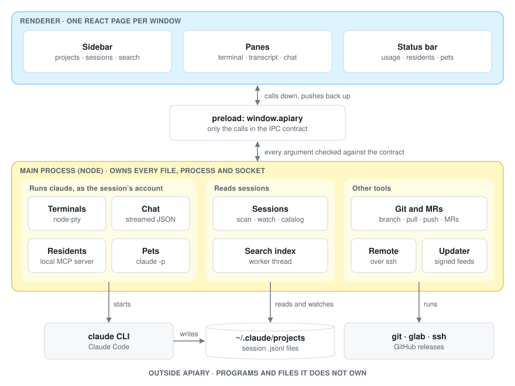
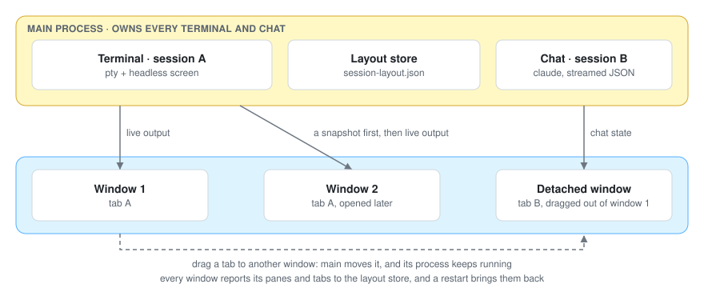
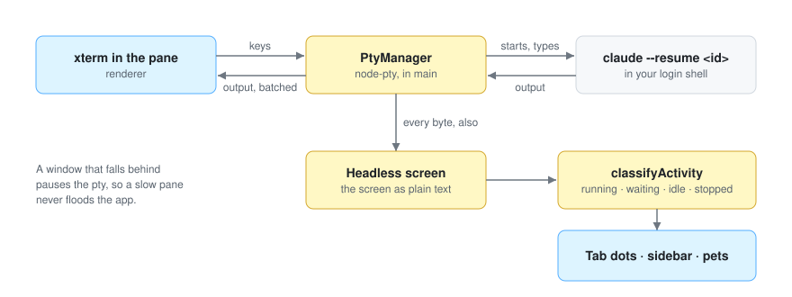
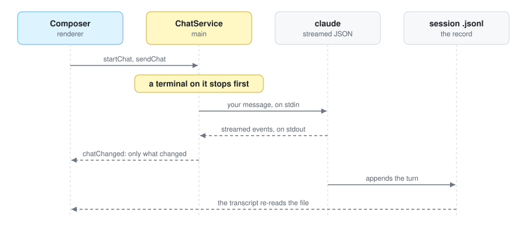
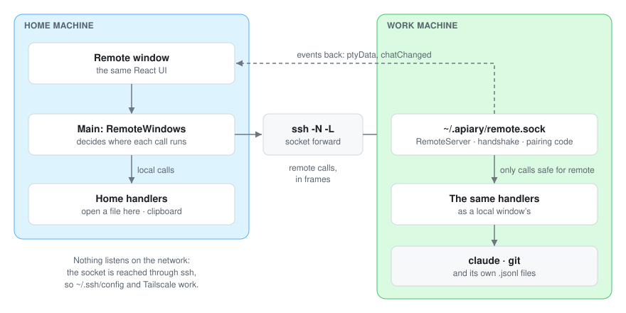
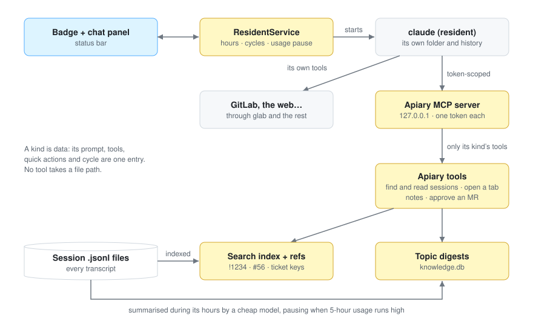
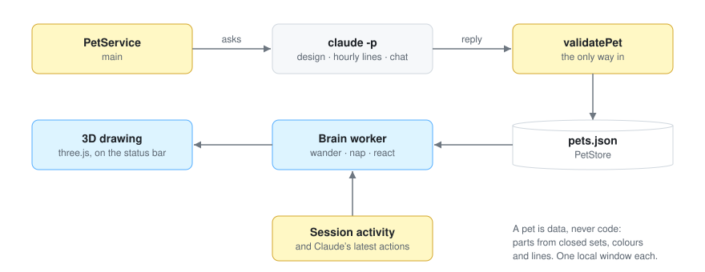

# Apiary

One desktop app for every Claude Code session on your machine: find any conversation in seconds,
pick it up where it left off, and work on several side by side, even on another computer.

![Apiary in its default Liquid Glass theme: a searchable sidebar with an Active section listing open sessions, Pinned and grouped sessions below it, and three sessions arranged in a layout — a chat in the large pane in the middle of a long run, with finished and pending tool calls, a thinking row, code and the working timer counting up above its message box; Claude Code's own terminal on the top right; and a chat on the bottom right where Claude asks a single multiple-choice question and the message box is folded away — with three fuzzy pets and the Claude plan-usage meter on the status bar along the bottom](docs/screenshot.png)

![Regent, Apiary's chief of staff, in a floating chat panel over a session pane: the earlier request "Open the session for !1175" with a possible-match card and a chip for the session it opened, which is open behind the panel, and the question "What auth did we design between core and wildobs?" answered in a short paragraph with two clickable session chips and a three-item bullet list; on the status bar below, the gold Regent bee and the MR desk's honey pot with a count badge and the text "2 MRs ready to approve"](docs/screenshot-regent.png)

*Regent, a chief of staff over all your sessions: ask it to find, open or answer from any of them. Beside it, the MR desk's honey pot says two merge requests wait for you.*


*Remote access: run Apiary on your work machine and use it from home over SSH or Tailscale. This window is the work machine's sessions, chats and slash commands, live.*

## Why Apiary

- **Every session in one place.** Apiary reads the session files Claude Code already writes, groups
  them by the folder they started in and nests git worktrees under their repository. There is
  nothing to set up and nothing copied.
- **Ask, don't search.** Regent knows every session: the merge requests and tickets they mention,
  and digests of the topics inside long ones. Ask it to open the right one, or to answer from them.
- **Find it again.** Fuzzy search over titles and your own notes, plus Pinned, Active and Recent
  lists, so last month's session is a few keystrokes away.
- **Pick up where you left off.** Resume any session in its own working directory, in a terminal or
  as a chat. Both drive the same `claude --resume`, so the transcript stays the one record.
- **Several at once.** Tabs, layouts of up to four panes, windows of their own, and a shell beside
  every session.
- **Your work machine, from home.** Open the Apiary on another computer over SSH or Tailscale, the
  way VS Code Remote-SSH works: its sessions, terminals and chats in a window here, arranged in
  the same groups and pins. Nothing listens on the network.
- **Git where the session is.** Branch, pull, push and the merge request for each session's own
  folder, without leaving it.

## Features

- **Import on your terms:** nothing appears until you import it; a ticked folder brings in new
  sessions on its own.
- **Transcripts** rendered as markdown, tool calls folded away, images inline.
- **Chat** with a session while it works, with pasted or dropped images.
- **Start, fork, rename, note, pin, hide** a session, or drag it to another worktree.
- **Git toolbar** per session: branch switcher, ahead and behind, pull, push, and help when a branch
  is checked out in another worktree.
- **GitLab merge requests** for the current branch, and their status beside `!1234` in titles,
  through `glab` (no token stored).
- **Residents** (optional, in Settings → Residents): always-on Claude agents with a badge on the
  status bar, their own hours, and a chat panel. Right-click a badge for its quick actions, such
  as turning it off, its settings, or the kind's own.
  - **Regent** answers from all your sessions. Click the bee or press ⌘⇧Space, or press ⌘↵ in the
    sidebar search. It opens a session or answers with chips that open the ones it used, and keeps
    its history across restarts. It has Claude's full tools, asking permission in the chat as chat
    mode does. During its hours, a cheap model writes topic digests of your sessions, looking back
    as far as you choose and pausing when your 5-hour usage passes a level you set.
  - **The MR desk** watches the GitLab merge requests you review through `glab`: it reviews new
    ones, checks threads and tells you which are ready to approve. Its honey pot shows a count and
    a line when something needs you. Right-click it for Show the desk and Stats.
  - **Links find their session:** paste a merge request, issue or Jira link, or a ticket key, in the
    sidebar search to find the session that mentioned it.
- **Remote access** over SSH: hosts from `~/.ssh/config`, recent connections and Tailscale;
  reconnects on its own; starts Apiary on the work machine if it is not running; optional pairing
  code. On a Linux work machine, from an SSH shell:
  - `apiary --update` installs the newest release (sudo asks for your password in the terminal)
    and restarts the Apiary that is running, the way it was started.
  - `apiary --background` starts it with no window, even with nobody logged in to the desktop.
  - `apiary --update --background` does both.
  - Open Apiary on that machine's desktop later and it joins the background one: the same
    sessions, terminals and chats, with nothing restarted.
  - `apiary --install-service` keeps it running for good: a systemd user service that starts
    with the machine and survives logging out (`apiary --uninstall-service` removes it).
- **Open in VS Code**, locally or over Remote-SSH from a remote window.
- **Themes**, including Liquid Glass, or describe one and Claude designs it.
- **Pets** (optional): small 3D characters on the status bar that react to what Claude is doing.
- **Several Claude accounts:** new sessions start in the default account from Settings, and any
  session can move to another one from its `/` menu or tab, without signing out anywhere else.
- **Remembers everything** across restarts: windows, layouts, tabs, and sessions that were running.
- **Keeps itself up to date** from GitHub releases.
- **Errors in plain words**, with the raw error a click away, and an opt-in diagnostic log that
  never records your conversations.

## Install

There's no signed installer yet, so the reliable way to get Apiary onto a
machine is to hand an AI coding agent with shell access (Claude Code, Cursor,
etc.) the install prompt:

**[docs/install-prompt.md](docs/install-prompt.md)** — open it and use the
file view's own copy button, then paste the whole thing into your agent.

It's kept as a file of its own, containing nothing but the prompt, precisely so
that copying it is one button rather than a careful drag across part of a page.

Once installed, Apiary updates itself: it checks for new releases and offers
them in the app. The prompt is still idempotent — running it again later
checks the installed version against the latest release and does nothing if
you're already up to date, or updates in place if you're not. If a GitHub release
exists for your platform it downloads the prebuilt artifact; otherwise (or if
none has been published yet) it builds from source instead, which always works
as long as the build requirements below are met.

## Requirements

To run a prebuilt release:

- macOS or Ubuntu 24.04
- `claude` on your `PATH`

To build from source, additionally:

- Node 22.22.1 or newer (see [CONTRIBUTING.md](CONTRIBUTING.md) for the full dev setup)

## Development

See [CONTRIBUTING.md](CONTRIBUTING.md) for setup and the contributor workflow. Quick reference:

```sh
npm install
npm start             # run the app
npm test               # unit and integration tests
npm run test:component # renderer tests in headless Chromium
npm run test:e2e       # Playwright tests against the built renderer (off-screen; APIARY_HEADED=1 to watch)
npm run test:e2e:smoke # the ~1 minute subset that also runs in CI
npm run typecheck
npm run lint            # eslint, stylelint, markdownlint, shellcheck, dependency-cruiser
npm run screenshot         # regenerate docs/screenshot.png (the first README image)
npm run screenshot:regent  # regenerate docs/screenshot-regent.png (Regent and the MR desk, with stand-in claude and glab)
npm run screenshot:remote  # regenerate docs/screenshot-remote.png (needs Docker)
```

`npm run screenshot` launches the real app against a representative fixture (project
folders, a git worktree, sessions with human-sounding titles), opens three sessions in a
layout, and overwrites `docs/screenshot.png` — see `scripts/screenshot/screenshot.spec.ts`.
The two chat panes open on conversations written by `scripts/screenshot/stories.ts` and
continue them with `scripts/screenshot/fake-claude-chat.mjs` (one turn that never finishes,
one that ends in a question); the terminal pane runs `scripts/screenshot/fake-claude.sh`,
which prints a fixed Claude Code screen. The usage meter shows numbers fed through
`APIARY_FAKE_USAGE`, so nothing reads a real token. The real CLI needs an API key and a
network and would render something different every run, neither of which belongs in a
committed image. The script waits about a minute so the chat's timer reads over a minute.
`npm run screenshot:remote` makes the second picture for real: it builds and starts the
Docker test bed of `npm run test:remote` (an Ubuntu container running the built app as the
work machine), connects this machine's app to it over SSH, sends one message in a chat and
opens the `/` menu, then photographs only the remote window. The first run builds the image
(minutes, several GB; keep disk free). See `scripts/screenshot/remote.shot.ts`. The container's
`claude` is the same stand-in. It's a Playwright
script, not a test (it asserts nothing, and lives outside `tests/e2e` so
`npm run test:e2e` never runs it); run it by hand whenever a change is significant
enough that the README's picture of the app should catch up.

`postinstall` runs `scripts/fix-node-pty-permissions.mjs` automatically after
`npm install`. node-pty ships a small native helper binary, `spawn-helper`,
that it execs before exec'ing your shell; npm's tarball extraction doesn't
reliably preserve its executable bit, and without it every terminal spawn
fails with `posix_spawnp failed`. The script restores the bit, unconditionally
and harmlessly, every time dependencies are installed.

## Architecture

Apiary is an Electron app, so it has two halves:

- **The renderer** is the UI: one React page per window.
- **The main process** is Node: it owns every file, process and socket.

The renderer never touches the disk or starts a program. It can only make the calls listed in one
contract (`src/shared/ipc/contract.ts`), which preload exposes as `window.apiary`. Main checks
every argument against that contract before a handler runs. Everything Apiary shows comes from
things it does not own: Claude Code's session files, the `claude` CLI, `git`, `glab` and `ssh`.

In every picture, blue is the renderer, amber is the main process, and grey is outside Apiary.



**Three rules hold everywhere.**

- **A session's `.jsonl` file is the record.** Claude Code writes it, and Apiary only reads it:
  titles, working folder and transcript all come from there. Apiary keeps its own state (layouts,
  settings, pets, residents) in versioned JSON files under its userData folder.
- **Main pushes, the renderer listens.** A renderer subscribes to a push (`ptyData`, `chatChanged`,
  `activityChanged` and others), and main sends each one only to the windows that show that
  session.
- **Every `claude` Apiary starts runs under its session's account.** An added Claude account is a
  config folder that Apiary passes as `CLAUDE_CONFIG_DIR`. It links back to the main one for the
  transcripts, settings, skills and plugins, and keeps only its own login. Terminals, chat,
  residents, pets and digests all start `claude` the same way. So moving a session to another
  account changes only who it signs in as, and every transcript stays in one place for the sidebar
  and search.

### Windows and tabs

Main owns every terminal and chat; a window only shows them. Two windows can show the same session,
both attached to the one process. A window that attaches late (a second window, a tab switched
back to) is caught up from a rendered snapshot of the screen, not by replaying old output. Dragging
a tab to another window, or out into a window of its own, moves the tab and leaves its process
running. Each window reports its panes and tabs, and main saves them, so a restart brings back the
windows, the layout and the sessions that were running.



### Terminals

A terminal pane is a real pty running `claude --resume <id>` through your login shell. Main keeps a
second, headless copy of each screen. It reads that screen to tell whether the session is running,
waiting for you or idle. That status drives the tab's dot, the sidebar and the pets.



### Chat

Chat drives the same session without a terminal. Main runs `claude` with streamed JSON in and out,
and turns its output into one `ChatState`. Main sends only the fields that changed, to the windows
showing that chat. The transcript still reads the `.jsonl`; the streamed state only fills the gap
until the file catches up. A permission request from Claude shows up in the chat as a question.



### Remote access

The work machine runs its own Apiary, listening on a Unix socket in `~/.apiary` (nothing listens
on the network). The home machine reaches that socket through `ssh`'s socket forwarding, so
anything ssh can reach works: `~/.ssh/config` hosts and Tailscale. A remote window is an ordinary
renderer. Main forwards its remote calls over the socket, and they run through the same handlers
as a local window's. The work machine answers only calls marked safe for remote use.



### Resident agents

A resident (Regent, the MR desk) is a long-running `claude` with its own folder, hours and chat
panel. It acts in Apiary through tools served by Apiary's own MCP server on `127.0.0.1`. Its token
names the resident, and the resident's kind decides which tools it may call. No tool takes a file
path. A kind is data: its prompt, tools, quick actions and cycle are one entry, so a new kind needs
no changes to the service or the UI.

Regent answers from two things built from your transcripts. The search index holds every
session's text plus its refs: the merge requests, issues and ticket keys it mentions, so a pasted
link finds its session by an exact match. The topic digests are short summaries that a cheap model
writes during Regent's hours, pausing when your 5-hour usage passes the level you set. A search
rebuild never touches the digests, because they cost your quota to make.



### Slack

Apiary can read your messages in one Slack channel per machine and act on them through Regent. It polls
Slack's Web API (no Socket Mode, so two machines never steal each other's messages). A top-level
message is a task: Regent finds or starts a session, passes your request on and reports milestones in
the thread. Permission prompts reach the thread as cards you answer by typing `allow`, `deny` or
`allow all`. Only your own member id is obeyed. See [docs/slack.md](docs/slack.md) and
[docs/architecture/slack-desk.md](docs/architecture/slack-desk.md).

### Pets

A pet is data, never code: parts from closed sets, plus colours and lines. Claude designs one
through `claude -p`, and every pet goes through `validatePet` before it is kept or drawn. A worker
in the renderer runs its behaviour, and three.js draws it. A pet reacts to the activity of your
sessions. Each pet lives in one local window, never a remote one.



### What Apiary refuses to do

The security rules, in one place. Each is enforced by a check in the repo, listed in
[CLAUDE.md](CLAUDE.md).

- **The renderer never hands main a file path.** It sends an id, and main looks up the path
  itself, confined to the folder it belongs in.
- **No call skips the contract.** Every IPC argument is checked by the contract's guard before a
  handler runs, and only Apiary's own pages may call at all.
- **A remote window cannot reach the work machine's screen.** The work machine serves only calls
  marked safe for remote use. Anything that would open a dialog, a browser or the clipboard there
  is refused or answered at home.
- **A resident gets only its kind's tools.** Its token names it, the token is never on a command
  line, and no tool takes a path.
- **Pets and themes are data, never code.** `validatePet` and `validateTheme` are the only way in.
- **Claude's login token is read only after you agree**, for the usage meter, and is sent only to
  Anthropic.
- **An update is installed only from a signed feed.** The app checks the release's signature before
  it trusts any hash in it.
- **The diagnostic log never records your conversations.**

The pictures are drawn by `scripts/diagrams/architecture.mjs`: edit one there and run
`npm run diagrams` to rewrite `docs/architecture/img/`. The details behind each picture are in [docs/architecture/](docs/architecture/), in the
`CLAUDE.md` file beside each subsystem in `src/`, and in the decision records in
[docs/adr/](docs/adr/).

## Packaging

Building installers for distribution (`npm run dist` and friends) is maintainer-facing detail —
see [docs/packaging.md](docs/packaging.md).

## How it works

Sessions are discovered by scanning the Claude config directory. Metadata is read
with bounded head and tail reads rather than parsing whole files, because session
files reach tens of megabytes. Titles come from the `ai-title` entries Claude Code
writes. Working directories are always read from the `cwd` field inside the JSONL,
never derived from the directory name, which is a lossy encoding of the path.

Nothing appears in the sidebar until you import it through File, then Import Claude
Sessions. Ticking a folder also marks it for auto-import, so sessions you start
later in that folder show up on their own.
