# Apiary under load: 6 agent sessions in 2 windows

2026-10-17, Apiary 1.44.1, Electron 44. The questions:

- With six Claude agents running in two windows, how much CPU and memory does Apiary use?
- Why does typing in a message box feel slower on Ubuntu than on a Mac, what would fix it, and is
  it worth it?
- Would a rewrite (a Rust backend, another framework) pay for itself?

## Short answer

**Fixed in 1.44.3–1.45.0** (see "After the fixes" below). With six agents in two windows, on Linux with
2 CPUs drawing in software: key press to painted frame p95 **92 → 23 ms**, keys over 50 ms
**10.6% → 0.2%**, frames over 50 ms **519 → 2 a minute**, long tasks **52 → 0 ms a second**. Over ten
minutes: p95 100 → 26 ms, keys over 50 ms 27% → 0.1%. On the Mac: p95 34 → 25 ms, worst key 712 → 46 ms.

What follows is the investigation that led there.

- **Apiary itself is light. The six `claude` CLIs are not.** On an M4 Mac with six real Haiku
  agents, Apiary's own processes average 16–23% of one core and about 0.9–1.1 GB. The six `claude`
  processes average 25–30% of a core and 1.5–1.7 GB. With the same windows open and no agents
  running, Apiary uses 4% of a core and 840 MB.
- **Typing slows under load everywhere, badly on a Linux desktop drawing without its GPU.** Key
  press to painted frame, p95:
  - Mac: 17 ms idle, 34 ms with six agents.
  - Linux container with software rendering and 2 CPUs: 19 ms idle, **92 ms** with six agents.
    One key in ten takes over 50 ms, and over 500 frames a minute take over 50 ms. Over ten minutes
    one key in four is over 50 ms.

  That matches what you see on Ubuntu.
- **Two things cause it, and neither is the main process:**
  1. **Animations that never stop.** While agents work, every window keeps spinners turning: an
     activity ring with a glow on each running session in the sidebar and on each tab, plus the
     working-line and tool-call pulses. With a GPU that is nearly free. Without one, Chromium
     composites the whole window in software every frame. Its compositor thread was **98.5% busy**
     under load, against 28% idle.
  2. **Chat updates.** Each streaming chat updates its pane up to 25 times a second. Each update is
     a 160–340 KB message holding the whole chat state, then a React render and a layout.
- **Fixing both makes typing under six agents as fast as idle.** Measured on Linux with 2 CPUs:
  key p95 92 → **23 ms**, worst key 218 → 31 ms, slow keys 10.6% → 0, frames over 50 ms
  519 → 1 a minute. Three changes did it: smaller chat updates, sent at most every 120 ms instead of
  40 ms, and no continuous animations. Each is a day or less.
- **A rewrite is not justified.** Main's JavaScript is 96–98% idle under the full load. A Rust
  backend could save at most the 2–4% that is left, and none of the drawing. See "Rewrite?".
- **Check first that the Ubuntu box draws with its GPU.** It is free to check, and it is probably
  the difference between the Mac and Ubuntu (see "Running it on the Ubuntu box").

## After the fixes

What shipped, each measured with the same harness and recordings as the baselines above:

| Version | Change |
| --- | --- |
| 1.44.3 | A chat update carries only the fields that changed, sequence-checked so a window can never apply one onto a state it does not have; streamed text every 120 ms instead of 40 ms (P1 and slower updates) |
| 1.44.4 | Rows redraw only when their own content changes; the streamed reply parses only its last paragraph; the message box grows by CSS with no layout read per key; following the newest text reads layout once per frame (P2–P4) |
| 1.45.0 | Settings → Themes → Animations: Automatic (the default) stops every animation that never ends when Apiary draws without the GPU or the system asks for less motion, keeping still cues |

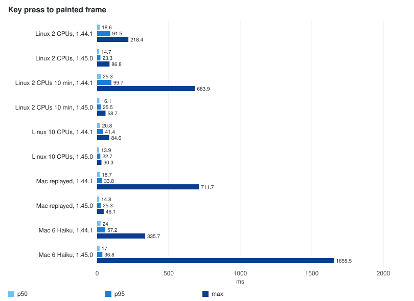

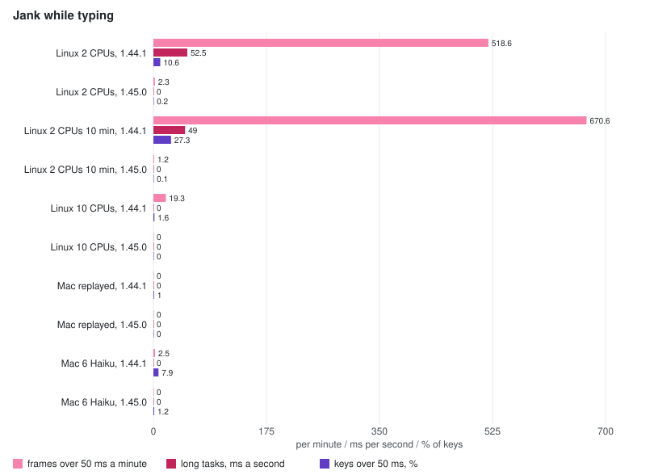

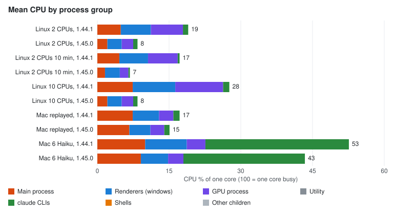

| Run | CPU total | Main | Renderers | GPU | claude | Memory total MB | Renderers MB | claude MB | Key p50 / p95 / max ms | Keys over 50 ms | Frames over 50 ms /min | Main loop p99 / max ms | IPC KB/s |
| --- | ---: | ---: | ---: | ---: | ---: | ---: | ---: | ---: | --- | ---: | ---: | --- | ---: |
| Linux 2 CPUs, 1.44.1 (mean of 4) | 19 | 4.9 | 6.3 | 6.7 | 1.1 | 1543 | 666 | 324 | 18.6 / 91.5 / 218.4 | 10.6% | 518.6 | 42.2 / 87.7 | 2862 |
| Linux 2 CPUs, 1.45.0 (mean of 2) | 8.4 | 2.1 | 3 | 2.4 | 0.9 | 1398 | 553 | 327 | 14.7 / 23.3 / 86.8 | 0.2% | 2.3 | 8.9 / 66.2 | 295 |
| Linux 2 CPUs 10 min, 1.44.1 | 17.2 | 4.6 | 6 | 6.2 | 0.4 | 1973 | 1076 | 339 | 25.3 / 99.7 / 683.9 | 27.3% | 670.6 | 54.2 / 1180.7 | 1458 |
| Linux 2 CPUs 10 min, 1.45.0 | 6.8 | 1.6 | 3.1 | 1.8 | 0.3 | 1776 | 894 | 342 | 16.1 / 25.5 / 58.7 | 0.1% | 1.2 | 9 / 68.4 | 261 |
| Linux 10 CPUs, 1.44.1 | 27.5 | 7.4 | 8.9 | 10 | 1.3 | 1513 | 647 | 324 | 20.8 / 41.4 / 84.6 | 1.6% | 19.3 | 7.4 / 23.5 | 3681 |
| Linux 10 CPUs, 1.45.0 | 8.4 | 2.1 | 3 | 2.4 | 0.9 | 1409 | 564 | 326 | 13.9 / 22.7 / 30.3 | 0% | 0 | 8.9 / 28.3 | 255 |
| Mac replayed, 1.44.1 | 17.2 | 7.4 | 5.5 | 3 | 1.3 | 1456 | 606 | 328 | 18.7 / 33.8 / 711.7 | 1% | 0 | 6.4 / 92.3 | 3721 |
| Mac replayed, 1.45.0 | 15.1 | 6.7 | 4.4 | 2.9 | 1.1 | 1352 | 610 | 293 | 14.8 / 25.3 / 46.1 | 0% | 0 | 6.8 / 13.6 | 236 |
| Mac 6 Haiku, 1.44.1 | 52.6 | 10 | 8.7 | 3.9 | 30 | 2758 | 662 | 1694 | 24 / 57.2 / 335.7 | 7.9% | 2.5 | 8.6 / 90.2 | 6389 |
| Mac 6 Haiku, 1.45.0 | 43.4 | 9.1 | 5.7 | 3.2 | 25.4 | 2866 | 544 | 1877 | 17 / 36.8 / 1655.5 | 1.2% | 0 | 7.8 / 36.7 | 420 |

- **On Linux drawing in software, typing under six agents is now as fast as with none** (idle was
  19 ms at p95), and stays so over ten minutes. Apiary's own CPU fell by about 60% (main, windows
  and GPU process together: 18 → 7.5% of a core on 2 CPUs).
- **On the Mac** (GPU in use, so animations stay on): p95 34 → 25 ms with replayed agents, 57 → 37 ms
  with real Haiku, and the worst keys of the replayed run 712 → 46 ms. The real-Haiku run had one key
  at 1.66 s; all of it was spent before the window received the key, while main's event loop never
  stalled more than 37 ms, so it was not Apiary's JavaScript (the browser side, the test driver or
  the OS scheduler).
- **Chat IPC is down 82–94%** (3.7 MB/s → 0.24–0.30 MB/s; 6.4 → 0.4 MB/s with real Haiku).
- **Still open:** the windows' memory still grows over a long session (about 400 MB → 1.2 GB in ten
  minutes, a little less than before); terminal sessions (xterm) are not covered by this harness yet.
- One 1.45.0 run on Linux (not in the table) had its end-to-end key times skewed by about 25 ms: the
  container's wall clock was adjusted mid-run while the window stamped keys from its page-load
  origin. The harness now stamps keys with the wall clock at the moment it handles them. The
  in-window time, which no clock affects, agrees with the table: p95 70–79 ms before, 19 ms after.

## Long sessions: memory

The windows' memory still grew over ten minutes after 1.45.0 (about 225 → 445 MB each), while their
JS heap stayed between 30 and 110 MB (rising and falling with garbage collection) and their DOM
levelled off. To separate the causes, a chat-mode transcript of 6,000 generated messages (a question,
a Read call with a 60-line result, and a reply with a code block, repeated) was opened and paged in
200 at a time, measuring after a forced garbage collection:

| Messages held | DOM nodes | JS heap | Window memory |
| ---: | ---: | ---: | ---: |
| 200 | 2,914 | 7 MB | 164 MB |
| 1,000 | 12,890 | 11 MB | 206 MB |
| 2,000 | 25,390 | 15 MB | 261 MB |
| 4,000 | 50,390 | 23 MB | 369 MB |
| 6,000 | 75,390 | 31 MB | 472 MB |

**Each message held costs about 53 KB of the window's memory, linearly, and almost all of it is the
mounted rows** (DOM, layout and paint data in Blink); the messages themselves are about 1.3 KB each in
the JS heap. Apiary never let go of a message: every refresh appended the newest ones and "Load
earlier messages" prepended pages, so an agent writing about 600 messages an hour added about 30 MB
an hour to its pane, about a gigabyte over six hours with six panes.

**What the Claude Code VS Code extension does** (its webview bundle, version 2.1.301): it renders
every held message (no virtualization), but caps the held list at 600 and trims it to about 500,
oldest first, never splitting a tool call from its result and keeping the newest 100 and anything
still running. Collapsed long outputs ("Show more", 250 px) stay mounted. VS Code's own chat view goes
further and virtualizes its list (rows recycled as they scroll). For a chat that follows the newest
message and pages history from disk, the usual answer is the extension's: a bounded window, with
earlier messages loaded back on demand. `content-visibility: auto` saves rendering work but not this
memory: the DOM stays.

**Apiary's fix** (1.46.0): a transcript following the newest messages holds at most 600, trimmed to 500 from
the oldest end, without splitting a tool call from its result; the earlier-messages cursor moves to
the first one still held, so scrolling back up loads them again from the session file, by itself as
you near the top. Nothing is trimmed while you read history or search. The once-a-second refresh now
reads only the messages after the last one held, instead of re-reading and re-sending the newest 200
(about 650 KB/s of IPC with six panes).

Measured on 1.46.0, a session written 100 messages every 2.5 seconds while its transcript follows
the newest: the window holds 500–600 messages however many are written, and its memory stays flat.

| Messages written | Rows held | DOM nodes | JS heap | Window memory |
| ---: | ---: | ---: | ---: | ---: |
| 200 | 200 | 2,580 | 7 MB | 155 MB |
| 1,200 | 601 | 6,993 | 9 MB | 179 MB |
| 2,200 | 601 | 6,993 | 9 MB | 181 MB |
| 3,200 | 601 | 6,993 | 9 MB | 183 MB |
| 4,200 | 601 | 6,993 | 9 MB | 183 MB |

Before, holding 4,200 messages cost about 400 MB and grew by about 53 KB with every message.

### More from the VS Code extension

What else its webview does that Apiary does not, ranked by value for the effort (memory first):

1. Tool output kept as a tail with its total size ("Showing the end of X of output"), and a byte
   budget per tool group (about 192 KB) that drops outputs before calls.
2. Long text and diffs folded at about 250 px with "Show more / Show less" (Apiary could go further
   and mount a folded body only when opened).
3. Runs of tool calls folded into one "N tool calls" row, and consecutive Reads into "Read N files":
   fewer rows, less to read.
4. Each message decoded in its own try/catch on replay, with one merged "skipped" notice.
5. A todo card for `TodoWrite` and a plan card for `ExitPlanMode`.
6. A light diff view for Edit and Write.
7. Rewind to a message (with a dry run) and fork from it.
8. Stick-to-bottom details: a 50 px threshold, `scrollend` to settle, and noticing arrow, page and
   wheel scrolling away.

Apiary already has the interrupt, queued messages, the context ring, the background-task list, and a
task-output view that reads only while it is open.

## How it was measured

A reusable harness: `npm run bench:load` (`tests/e2e/bench/loadPerf.spec.ts`, settings in its
header). It opens Apiary with a saved layout of N sessions over M windows, one pane each. The
default is 6 in 2: three columns a window, glass theme. It starts an agent in each pane from that
pane's own message box. Then, for `APIARY_BENCH_SECONDS` (120), it samples:

| What | How | From |
| --- | --- | --- |
| CPU and memory of every Electron process (main, each window's renderer, GPU, utility) | `app.getAppMetrics()`, once a second | main, sampling itself |
| CPU and memory of the processes Apiary started (`claude`, shells, git) | `ps`, or `/proc` on Linux | the test runner |
| Main event loop delay (input reaches a window through main's UI thread) | `perf_hooks.monitorEventLoopDelay` | main |
| IPC messages and bytes sent to windows, per channel | `webContents.send`, wrapped | main |
| Key press to painted frame | a key every ~80 ms (about 12 a second) into the first message box of each window in turn; the window records the `keydown` and the frame after it | test runner and renderer |
| Frame intervals, long tasks, long animation frames with their scripts | `requestAnimationFrame`, `PerformanceObserver` | each renderer |
| CPU profiles of main and one window (`APIARY_BENCH_PROFILE=1`) | Node inspector in main, CDP `Profiler` in the window | `.cpuprofile`; open in DevTools or speedscope |
| A Chromium trace of every process (`APIARY_BENCH_TRACE=1`) | `contentTracing` | `trace.json`; open in Perfetto, or summarise with `scripts/bench/trace-summary.mjs` |

The agents come in three modes:

- **`haiku`** (the default): real `claude --model haiku`. Each agent reads a copy of `src/shared/`
  file by file and writes a few paragraphs about each, so the load mixes tool calls and streamed
  text.
- **`record`**: the same, and each session is recorded.
- **`replay`**: plays those recordings back at their recorded pace.

Where Apiary is concerned, replay matches the real runs closely: 23–24 chat updates a second and
3.7 MB/s, against 25–34 and 4–6 MB/s. It spends no tokens and needs no login, so it is what the
Linux runs and the before/after comparisons use. Its `claude` numbers are the stand-in's, not
Claude's.

Where it ran:

- **Mac**: M4, 10 cores, 16 GB, macOS 27, GPU compositing, windows on screen.
- **Linux**: the repo's Ubuntu 24.04 test-bed container (`tests/remote/docker/Dockerfile`), under
  Xvfb on the same Mac. It has no GPU, so everything is composited and rasterised in software, as
  on a Linux desktop whose GPU Chromium does not use. It ran with all 10 cores, and limited to 2
  (`--cpus=2`) to stand in for a busier or slower machine. It is not your Ubuntu box: the numbers
  show which way and how far things move, not what you will see there.

Each 2-minute run is one sample. Real-agent runs vary with what the model does, so a few ms or a
couple of % between single runs is noise. The Linux 2-CPU comparisons were repeated (2–4 runs
each); the charts show the means.

## Results

### Mac

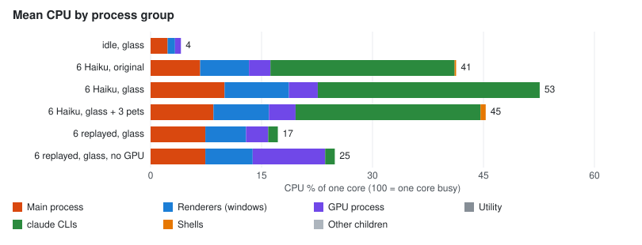

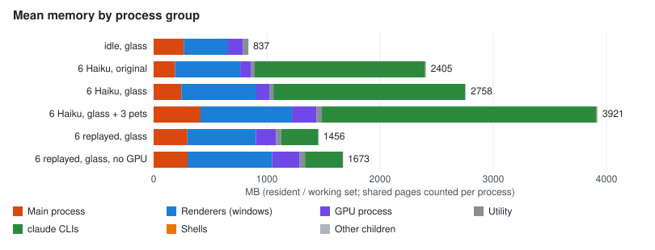

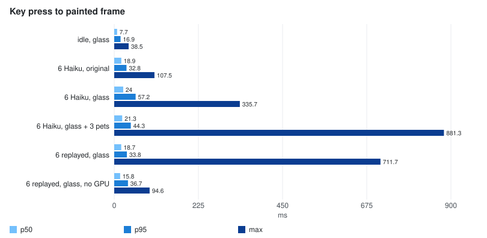

| Run | CPU total | Main | Renderers | GPU | claude | Memory total MB | Renderers MB | claude MB | Key p50 / p95 / max ms | Keys over 50 ms | Frames over 50 ms /min | Main loop p99 / max ms | IPC KB/s |
| --- | ---: | ---: | ---: | ---: | ---: | ---: | ---: | ---: | --- | ---: | ---: | --- | ---: |
| idle, glass | 4 | 2.3 | 1 | 0.8 | 0 | 837 | 391 | 0 | 7.7 / 16.9 / 38.5 | 0% | 0 | 6 / 38.9 | 0 |
| 6 Haiku, original | 41.4 | 6.7 | 6.6 | 2.9 | 24.9 | 2405 | 576 | 1505 | 18.9 / 32.8 / 107.5 | 1.3% | 0 | 8 / 65.6 | 5334 |
| 6 Haiku, glass | 52.6 | 10 | 8.7 | 3.9 | 30 | 2758 | 662 | 1694 | 24 / 57.2 / 335.7 | 7.9% | 2.5 | 8.6 / 90.2 | 6389 |
| 6 Haiku, glass + 3 pets | 45.3 | 8.5 | 7.5 | 3.6 | 25 | 3919 | 808 | 2426 | 21.3 / 44.3 / 881.3 | 3.3% | 0.5 | 7.5 / 118 | 4767 |
| 6 replayed, glass | 17.2 | 7.4 | 5.5 | 3 | 1.3 | 1456 | 606 | 328 | 18.7 / 33.8 / 711.7 | 1% | 0 | 6.4 / 92.3 | 3721 |
| 6 replayed, glass, no GPU | 24.9 | 7.4 | 6.4 | 9.8 | 1.3 | 1673 | 748 | 334 | 15.8 / 36.7 / 94.6 | 1.5% | 8 | 6.7 / 32 | 3814 |

CPU is % of one core; memory is resident set (each process counts the Chromium pages it shares).

- **Load.** Idle, Apiary uses 4% of a core. Six agents bring it to 16–23%: main 7–10%, the two
  windows 6–9% together, the GPU process 3–4%. The `claude` processes use more than Apiary does.
- **Glass and pets.** Glass against the original look, and three pets against none, are within
  run-to-run noise for CPU. Pets add memory:
  - Mac, in the one real-Haiku run with three pets: about 400 MB across main, the windows and the
    GPU process (their 3D renders), plus a `claude -p` process while a pet's lines are written.
  - Linux, where without WebGL the pets are drawn flat: about 65 MB.
- **No GPU** (`--disable-gpu`): the GPU process composites in software. Its CPU goes from 3% to 10%
  of a core, and frames over 50 ms appear (8 a minute) where there were none.
- **The worst single keys** (0.3–0.9 s) are rare, a handful per run. They wait before the window
  receives them, in Electron's browser process, not in Apiary's renderer code.

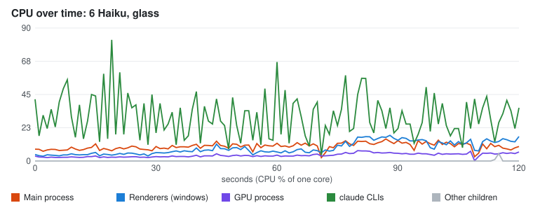

### Linux, software rendering

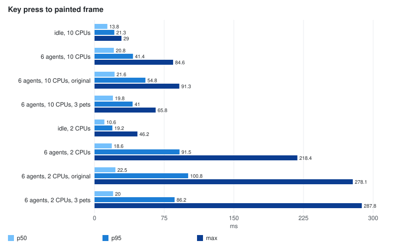

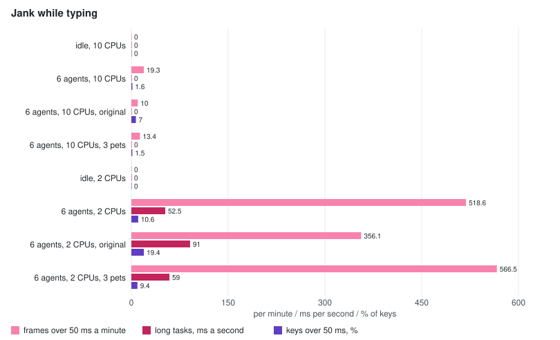

| Run | CPU total | Main | Renderers | GPU | claude | Memory total MB | Renderers MB | claude MB | Key p50 / p95 / max ms | Keys over 50 ms | Frames over 50 ms /min | Main loop p99 / max ms | IPC KB/s |
| --- | ---: | ---: | ---: | ---: | ---: | ---: | ---: | ---: | --- | ---: | ---: | --- | ---: |
| idle, 10 CPUs | 5.3 | 1.2 | 1.3 | 2.8 | 0 | 937 | 439 | 0 | 13.8 / 21.3 / 29 | 0% | 0 | 7.5 / 16.3 | 0 |
| 6 agents, 10 CPUs | 27.5 | 7.4 | 8.9 | 10 | 1.3 | 1513 | 647 | 324 | 20.8 / 41.4 / 84.6 | 1.6% | 19.3 | 7.4 / 23.5 | 3681 |
| 6 agents, 10 CPUs, original | 26.8 | 8.9 | 8.7 | 7.8 | 1.4 | 1502 | 650 | 324 | 21.6 / 54.8 / 91.3 | 7% | 10 | 7.4 / 106.2 | 3726 |
| 6 agents, 10 CPUs, 3 pets | 26.8 | 6.9 | 8.7 | 10 | 1.3 | 1581 | 697 | 324 | 19.8 / 41 / 65.8 | 1.5% | 13.4 | 7.4 / 97.9 | 3682 |
| idle, 2 CPUs | 5.3 | 1.3 | 1.3 | 2.8 | 0 | 934 | 437 | 0 | 10.6 / 19.2 / 46.2 | 0% | 0 | 7.6 / 28.1 | 0 |
| 6 agents, 2 CPUs (mean of 4) | 19 | 4.9 | 6.3 | 6.7 | 1.1 | 1543 | 666 | 324 | 18.6 / 91.5 / 218.4 | 10.6% | 518.6 | 42.2 / 87.7 | 2862 |
| 6 agents, 2 CPUs, original | 18.5 | 6 | 6.1 | 5.2 | 1.2 | 1538 | 676 | 324 | 22.5 / 100.8 / 278.1 | 19.4% | 356.1 | 50.2 / 84.3 | 2736 |
| 6 agents, 2 CPUs, 3 pets | 19 | 4.8 | 6.5 | 6.7 | 1.1 | 1585 | 704 | 324 | 20 / 86.2 / 287.8 | 9.4% | 566.5 | 40.4 / 85.9 | 2896 |

- **10 cores:** the Linux container types about as well as the Mac (p95 41 ms) but already drops
  frames, 19 a minute over 50 ms.
- **2 cores:** it does not keep up. Key p95 is 92 ms (88–94 over four runs), one key in ten is over
  50 ms, and over 500 frames a minute are over 50 ms.
- **Glass and pets are not the problem.** The original look is no faster, and pets cost nothing
  measurable here.
- The CPU columns look low (19% of a core) because the container's 2 CPUs are also shared with
  Xvfb and the test runner. The trace below shows where the time actually goes.

### Over time

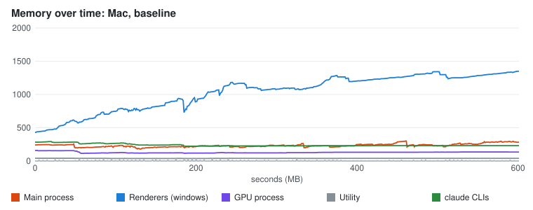

| 10 minutes | Key p50 / p95 / max ms | Keys over 50 ms | Frames over 50 ms /min | Renderers MB, start → end | IPC KB/s |
| --- | --- | ---: | ---: | --- | ---: |
| Mac | 24 / 42 / 270 | 1.9% | 0.2 | 430 → 1350 | 2054 |
| Mac, P1–P4 | 21 / 35 / 496 | 0.9% | 0 | 450 → 1000 | 295 |
| Linux, 2 CPUs | 25 / 100 / 684 | 27.3% | 671 | 480 → 1370 | 1458 |
| Linux, 2 CPUs, P1–P4 | 26 / 99 / 951 | 25.6% | 648 | 470 → 1320 | 339 |

Over ten minutes, CPU levels off after the first two and typing does not get worse with time.
Memory does grow:

- **The two windows' renderers grow from about 450 MB to 1.35 GB.** The curve flattens, which looks
  more like the growing DOM of six long transcripts (hundreds of tool calls, each showing a file)
  than a leak. It is still worth a look; the harness now records each window's JS heap at the end
  (`rendererByWindow[].jsHeapMbAtEnd`) to tell JS from DOM.
- **Each chat update grows from 78 KB to 338 KB** as the chat's list of streamed messages fills up
  (it keeps the last 200).

## Where the time goes

**CPU profiles** under the full load, 15 seconds each (`main.cpuprofile`, `renderer-w1.cpuprofile`):

- **Main process: 96–98% idle.** What does run is reading transcript pages, parsing claude's output
  lines and sending updates, each well under 1% of the thread. The 5–10% of a core that
  `getAppMetrics` reports for main is mostly Chromium's own browser-process work (IPC, input,
  window compositing), not Apiary's JavaScript.
- **One window's renderer: 82–85% idle.** Apiary's own JavaScript is about 2–3%: React reconciling,
  markdown parsing and sanitising, formatting message times. About 11–12% is "(program)", Blink's
  native style, layout and paint. Playwright's injected code adds about 2%; that is harness
  overhead, the same in every run.

**A Chromium trace** (Linux, 2 CPUs, six agents; `scripts/bench/trace-summary.mjs`) names the rest:

| Thread | Busy (15 s) | Mostly |
| --- | --- | --- |
| GPU process, Viz compositor | **98.5%** | `SoftwareRenderer::DoDrawQuad` 10.3 s: compositing the windows on the CPU |
| Window 1 renderer, main | 27.5% | style and layout 1.4 s, of which 0.5 s forced by a script reading layout; script 0.5 s; paint 0.2 s |
| Browser (Electron main), main | 17% | receiving and sending IPC |
| Window 2 renderer, main | 15% | the same as window 1 |

The same trace with no agents running (only the typing) has the compositor at 28%. With
animations switched off and the six agents still running, it is also 28%. **The compositor is
saturated by the animations, not by the conversation.**

What was found in the code, beyond the traces:

- **The update stream.** Every `chatChanged` carries the whole `ChatState`, including the last 200
  streamed messages with full tool results: 160–340 KB per update, 25–34 updates a second for six
  agents (4–6 MB/s). Main serialises it each time and the window parses it each time.
- **Every update re-renders every row.** `chatItems` rebuilds the timeline's items on each update,
  and `Item` is not memoised, so every row of all three panes in a window renders again. The
  streamed reply is re-parsed from its start on every update.
- **Typing forces a synchronous layout of the whole window on every key.** `useComposerHeight` sets
  the height to `auto` and then reads `scrollHeight`, and streamed replies keep the layout dirty.
- **The animations** that run while agents work, all infinite and all composited every frame:
  - the activity ring on each running session, in the sidebar's Active list and on its tab
    (`status-spin` in `20-sidebar.css` and `30-panes.css`): a 10 px ring with a blurred glow;
  - the tool-call and status pulses (`chat-pulse`, `chat-status-pulse` in `33-chat.css`);
  - `status-breathe` dots.

  The working line's glyph is separate: JavaScript at about 8 frames a second (`WorkingLine.tsx`).

## What would help, measured

Prototypes on throwaway branches, measured with the same harness (replay, glass theme):

| Prototype | Where | Change |
| --- | --- | --- |
| P1 Send only what changed | `ChatService.onChanged`, `chatStore` | an update carries only the top-level fields whose reference changed since the last one; the window merges it onto what it has |
| P2 Memoised rows | `ChatTimeline` | `Item` is memoised on its fields, so a row that did not change does not render |
| P3 Streamed reply in two parts | `ChatTimeline` | the reply is split at its last paragraph break; the finished part keeps its parsed HTML |
| P4 Self-sizing message box | `useComposerHeight` | `field-sizing: content` with a minimum and maximum height, instead of measuring on every key |
| P5 One update per frame | `chatStore` | updates are held and applied in one `requestAnimationFrame` per window |
| Slower updates | `ChatSession` | streamed text reaches the window every 120 ms instead of every 40 ms |
| Animations stepped / off | the harness (`APIARY_BENCH_STEPPED_ANIMATIONS`, `APIARY_BENCH_NO_ANIMATIONS`) | `steps(4)` timing on every animation, or none at all |

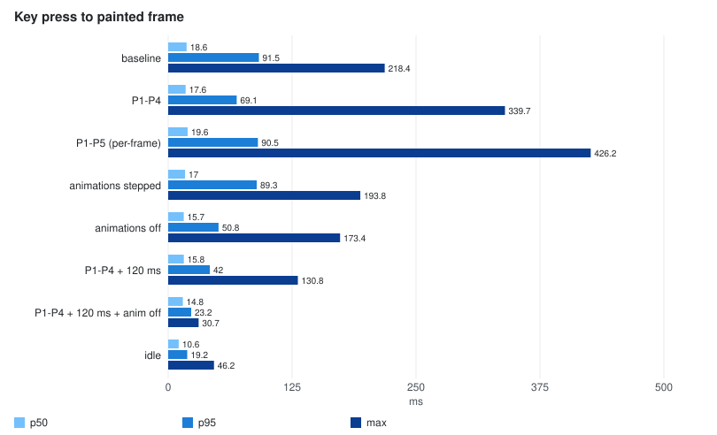

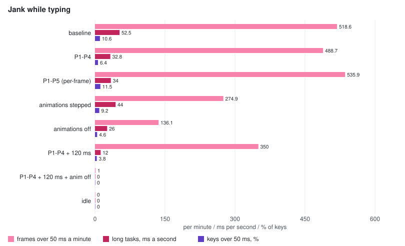

| Linux, 2 CPUs, six agents | Key p50 / p95 / max ms | Keys over 50 ms | Frames over 50 ms /min | Long tasks ms/s | Chat IPC KB/s |
| --- | --- | ---: | ---: | ---: | ---: |
| Baseline (4 runs) | 18.6 / 91.5 / 218 | 10.6% | 519 | 52.5 | 2862 |
| P1–P4 (4 runs) | 17.6 / 69.1 / 340 | 6.4% | 489 | 32.8 | 364 |
| P1–P5 (3 runs) | 19.6 / 90.5 / 426 | 11.5% | 536 | 34.0 | 382 |
| Animations stepped (2 runs) | 17.0 / 89.3 / 194 | 9.2% | 275 | 44.0 | 2853 |
| Animations off (2 runs) | 15.7 / 50.8 / 173 | 4.6% | 136 | 26.0 | 3224 |
| P1–P4, updates every 120 ms (2 runs) | 15.8 / 42.0 / 131 | 3.8% | 350 | 12.0 | 304 |
| **P1–P4, every 120 ms, animations off (2 runs)** | **14.8 / 23.2 / 31** | **0%** | **1** | **0** | 351 |
| Idle, no agents | 10.6 / 19.2 / 46 | 0% | 0 | 0 | 0 |

On the Mac (one run each), P1–P4 took typing p95 from 34 to 30 ms and the worst key from 712 to
62 ms, and cut chat IPC from 3.7 MB/s to 0.4 MB/s.

- **P1 cuts chat IPC by 87–90%** in every setting.
- **P1–P4 help the renderer** (long tasks −38%, slow keys −40%) but not the compositor.
- **P5 does not help.** One update per frame does not reduce what has to be drawn, and it piles a
  frame's worth of updates into the frame that also shows the key. It was dropped.
- **Stepping the animations frees the compositor** (98.5% busy → 34.5%, dropped frames halved), but
  typing still waits on the renderer.
- **Slower updates relieve the renderer:** long tasks 52 → 12 ms a second.
- **Only both together reach idle.** With P1–P4, updates every 120 ms and no continuous animations,
  typing under six agents is as fast as with none.
- None of these change main-process CPU, as the profiles predicted.

### Effort and payoff

| Change | Effort | Gain (Linux, 2 CPUs, software rendering) | Do it? |
| --- | --- | --- | --- |
| Check the GPU on the Ubuntu box (below) | minutes | if it reads "software", likely all of the difference from the Mac | yes, first |
| Log GPU status at startup (`app.getGPUFeatureStatus()`) to the diagnostic log | an hour | the next "slow on Linux" report answers itself | yes |
| Running spinners that do not composite every frame: a static ring with a slow pulse, no blurred glow on what moves, and in software compositing (or with reduced motion) no infinite animation at all | half a day, with a UI review | dropped frames −74%, slow keys −57% | yes |
| Streamed text every 100–120 ms instead of 40 ms | an hour | long tasks −77% (with P1–P4); text arrives in slightly larger steps | yes |
| P1 send only what changed | half a day, with tests and the contract clause | chat IPC −87–90%; less garbage and parsing | yes |
| P2 memoised rows, P3 streamed reply in two parts, P4 self-sizing message box | half a day together | renderer work and a forced layout per key | yes, cheap |
| P5 one update per frame | — | none measured | no |
| Look into renderer memory growth (450 MB → 1.35 GB in ten minutes) | a day | memory over a long day | yes, after the above |
| Terminal sessions: xterm's WebGL renderer (`@xterm/addon-webgl`) | a day | not measured here: the harness drives chat mode, and terminals draw with xterm's DOM renderer | measure first: extend the harness to terminal mode |
| Move main's work to a `utilityProcess` or a worker | days | main's JavaScript is 2–4% of a core | no |
| Rust backend (napi-rs or a sidecar) | weeks | at most main's 2–4%; none of the drawing | no |
| Tauri or another shell | months | swaps Chromium for WebKitGTK on Linux: different rendering on Mac and Linux, and WebKitGTK's own Linux GPU problems | no |

## Rewrite?

No. The numbers say why:

- **A backend rewrite could only speed up main's JavaScript, and it is 96–98% idle under six
  agents.** Parsing claude's output, reading JSONL and sending updates cost a few percent of one
  core. Rust would make those few percent smaller. It would not touch the windows or the
  compositor, which is where typing waits. The same goes for moving main's work into a
  `utilityProcess`: right for heavy work, but there is none.
- **The cost is Chromium drawing the UI, and a Rust backend keeps Chromium.** Changing the UI layer
  (Tauri) would trade Chromium for the system webview: WebKit on macOS, WebKitGTK on Linux.
  - That gives up the identical rendering on Mac and Ubuntu that you want.
  - WebKitGTK has its own Linux GPU and compositing problems; Tauri's docs warn about NVIDIA and
    DMA-BUF rendering. It could easily be slower on exactly the machine in question.
  - The fixes above remove the cost within the current stack anyway.
- **The biggest processes are not Apiary's.** Each `claude` CLI uses about 250 MB and, while
  working, more CPU than Apiary does. Nothing in Apiary changes that.
- **When a rewrite would be justified:**
  - when a profile shows main's JavaScript busy (say above 30% of a core) with work that cannot
    leave the UI thread;
  - or when JSONL and search work grows with the library and starts to block it.

  Even then, the first step is moving that work into a `utilityProcess`, and only the hot path
  goes to Rust (a napi-rs module or a sidecar) if it is still too slow there. 1Password 8 is the
  usual example of Electron with a Rust core; its gains were in the core's own work, not in the UI.

## Native tools for measuring an Electron app

What the harness uses, and what to reach for by hand:

| Tool | For | How |
| --- | --- | --- |
| `app.getAppMetrics()` | CPU, memory and idle wakeups of every Electron process | in main; the harness samples it every second |
| `app.getGPUFeatureStatus()`, `app.getGPUInfo('complete')` | whether compositing, rasterisation and WebGL run on the GPU or in software (`chrome://gpu` in Chrome) | in main; the harness saves it in `result.json` |
| `contentTracing` | a Chromium trace of every process: style, layout, paint, compositing, raster, IPC, input latency | the harness with `APIARY_BENCH_TRACE=1`; open `trace.json` at <https://ui.perfetto.dev>, or summarise it with `node scripts/bench/trace-summary.mjs` |
| DevTools Performance and Memory panels | one window: flame chart, layout and paint, heap snapshots | View → Toggle Developer Tools in a dev build; record while typing |
| `--inspect` plus `chrome://inspect` | the main process: CPU profile, heap snapshot | `electron --inspect=9229 .`; the harness profiles main through Node's inspector instead |
| `perf_hooks.monitorEventLoopDelay` | whether main's thread stalls (a stall delays input to every window) | in main |
| `PerformanceObserver` for `event`, `long-animation-frame`, `longtask` | input-to-paint latency, and what ran in a slow frame | in a window |
| Linux: `pidstat -u -r -p <pids> 1`, `perf top`, `smem -k` | per-process CPU, native hot spots, and memory as PSS (RSS counts each window's shared Chromium pages again) | on the Ubuntu box |
| macOS: Activity Monitor, Instruments (Time Profiler) | the same on a Mac | — |

## Running it on the Ubuntu box

**Before anything else, check the GPU.** Run the benchmark once, then open
`bench-results/<label>/result.json` and look at `main.gpu.status`. `gpu_compositing` and
`rasterization` should read `enabled`. If they read `disabled_software` or `unavailable_software`,
Chromium draws everything on the CPU, as in the Linux runs above.

On Ubuntu that usually means the GPU is on Chromium's block list, the drivers are missing, or
Wayland and X11 are mismatched. Try launching with `--ozone-platform-hint=auto`, then with
`--ignore-gpu-blocklist`, and compare `bench:load` runs with each.

Display scaling matters too: a 4K screen at 200% paints four times the pixels of the windows
measured here.

```sh
npm ci && npm run bench:load                                   # six real Haiku agents, two windows
APIARY_BENCH_AGENTS=0 npm run bench:load                       # the same windows, idle
APIARY_BENCH_CLAUDE=record APIARY_BENCH_RECORD=~/bench-rec npm run bench:load   # and record them
APIARY_BENCH_CLAUDE=replay APIARY_BENCH_REPLAY=~/bench-rec APIARY_BENCH_TRACE=1 npm run bench:load
APIARY_BENCH_CLAUDE=replay APIARY_BENCH_REPLAY=~/bench-rec APIARY_BENCH_NO_ANIMATIONS=1 npm run bench:load
npm run bench:report -- --out bench-results/report bench-results/*/
```

- **Windows open on screen while it runs.** A window that is never shown never paints, which would
  hide the cost being measured.
- **Results** are in `bench-results/<label>/`:
  - `summary.json`;
  - `result.json`, every sample;
  - `window-*.png`, what was on screen;
  - the profiles and traces, when asked for.

## Caveats

- **The Linux runs are a container on a Mac** (Apple cores, Xvfb, software GL), not your machine.
- **The harness types through Playwright.** That goes through the browser process as a real key
  does, but adds its own round trip. The idle runs show that floor: 8–14 ms at p50.
- **Chat mode only.** Terminal sessions draw `claude`'s TUI with xterm.js, which is a different cost
  entirely (and there is a headless xterm per terminal in main). Extending the harness to terminal
  mode is the next step before deciding on xterm's WebGL renderer.
- **Removing animations was measured, not designed.** The fix needs a running state that still
  reads clearly without continuous motion, and a UI review.
- **Recordings of real sessions are not committed.** They carry the account and machine details
  `claude` reports. Record your own with `APIARY_BENCH_CLAUDE=record`.
