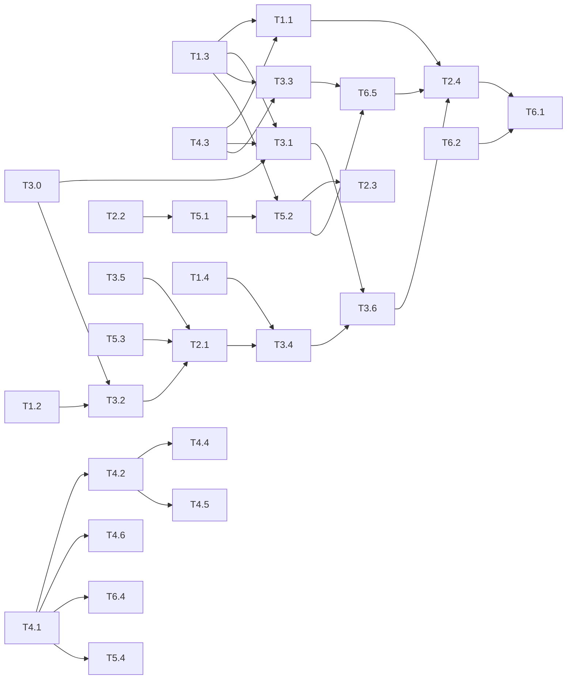

# Apiary architectural review, 2026-11-10

Reviewed at 1.59.14 (commit `2fa06edb`). This document is a work plan: 33 tasks a coordinator agent
can hand to sub-agents, each with its files, steps and the command that proves it. Sections 1 to 6
each give the current state, the problems found, the target, and the task specs. Section 7 is the
dependency graph and the rules that keep parallel agents out of each other's way.

## How to read this

**How the review was done.** One reviewer read the source on one machine (an M-series Mac): about
70,000 lines of `src/`, the test and CI configuration, and the nested `CLAUDE.md` files. Three
findings were confirmed by running a scratch test (marked **ran**); two numbers were measured with
`tsc` (marked **measured**); everything else comes from reading the code (marked **read**). Nothing
was measured at library scale: the existing load benchmark
(`docs/perf/2026-10-17-load-benchmark.md`) covers 6 active sessions, not thousands of stored ones.
Task T3.0 builds that benchmark, and every performance task after it reports before and after
numbers from it.

**Severity.** High: data is lost or hidden, or untrusted text can cause an action. Medium: wrong
behaviour at scale or under an unusual input, or a gap in a second line of defence. Low: debt that
makes the next change harder.

**What is already strong, and is not repeated below.** The IPC contract is declared once and the
preload, the handler types and the fake derive from it. The renderer is sandboxed with context
isolation and a strict content security policy. Every sender is checked and the check fails closed.
The renderer never supplies a path main acts on. Processes start only in `src/main/exec`. SSH runs
with `StrictHostKeyChecking=yes`, `BatchMode=yes` and the host after `--`. The diagnostic log
redacts secrets and never receives conversation text. The guard layer (30 architecture tests, the
`apiary/*` lint rules, empty baselines) is enforced in CI. These are the reasons most findings
below are about scale and edge cases, not structure.

### Task spec fields

Every task uses the same fields.

- **Scope:** what changes, and what must not.
- **Target files:** files to read first, and new files the task creates (marked "new").
- **Modified files:** the task's exclusive write set. A task edits nothing outside it. A test file
  listed here may be created if it does not exist.
- **Protocol:** the steps, in order. Step 1 is always a test that fails on the current code.
- **Verify:** the commands that must pass. Every task also runs `npm run typecheck && npm run lint`.
- **Depends on:** tasks that must be merged first. "None" means it can start now.

### Rules every task inherits

1. Follow root `CLAUDE.md`. Write the failing test first: the Stop hook
   (`.claude/hooks/testsFailOnBase.mjs`) rejects a behaviour change with no test that fails on the
   base.
2. Do not edit `package.json`, `package-lock.json` or `CHANGELOG.md`. Put the version line, the
   changelog text and any new npm script in the task report; the coordinator applies them at merge
   (section 7).
3. Do not push, tag or release. Do not add AI attribution to a commit.
4. Do not grow a baseline or an allowlist to make a check pass.
5. A task that changes what a person sees adds or updates a UI scenario and runs `npm run ui:review`.

## Findings at a glance

| ID | Severity | Evidence | Finding | Task |
| --- | --- | --- | --- | --- |
| D1 | High | ran | A session whose first message line is over 64 KB (a pasted image) is never listed | T1.1 |
| D2 | Medium | read | Session and project rows are never deleted; deleted transcripts stay as ghosts | T1.2, T3.2 |
| D3 | Medium | read | Four separate JSONL line readers; two ignore short reads; one buffers a whole oversized line | T1.3 |
| D4 | High | read | A killed pty is assumed dead after 1.5 s; chat take-over can leave two `claude` writers on one file | T1.4 |
| D5 | Medium | read | A prompt sent to a pty that has just exited is dropped without an error | T1.4 |
| D6 | Low | read | `PtyManager.entries` never shrinks; the exit signal is discarded | T1.4 |
| D7 | Medium | read | A half-written `sessions/<pid>.json` reads as "no session" for one tick | T1.5 |
| D8 | Medium | read | A corrupt settings or layout file is replaced with defaults on the next save, with no backup | T1.6 |
| A1 | Medium | read | `treeChanged` carries no payload and is the signal for 13 unrelated listeners | T2.1 |
| A2 | Medium | read | Resident kinds are a closed list in four places; no path for a third-party kind | T2.2, T2.3 |
| A3 | Low | read | Claude Code's JSONL format is parsed by hand in six places with casts | T2.4 |
| P1 | Medium | read | Every refresh pass (about one a second while any session writes) re-checks every session for the search index and rewrites the notes index | T3.2 |
| P2 | Medium | ran | Search keeps the first 2 MB of a session's text; the newest part of a long session is not searchable | T3.3 |
| P3 | Medium | read | A transcript page reads its whole byte range into memory before skipping oversized lines | T3.1 |
| P4 | Medium | read | Terminal output has no flow control; a flooding process saturates the main process | T3.4 |
| P5 | Medium | read | The session tree is re-fetched whole and every sidebar row re-renders on each change | T3.5, T2.1 |
| P6 | Medium | read | Find in transcript loads the entire history into the DOM; nothing is virtualized | T3.6 |
| P7 | Medium | ran | The remote frame decoder copies the buffer on every chunk: a 32 MB frame took 1,024 ms against 4 ms | T3.7 |
| P8 | Low | read | Remote events are written to the socket with no backpressure | T3.7 |
| Q1 | Medium | observed | Electron downloads are not cached in CI or the release; GitHub 504s failed three jobs on 2026-11-09 | T4.1 |
| Q2 | Medium | read | A failed nightly e2e run notifies nobody; no trace is kept for a failed test | T4.2 |
| Q3 | Medium | read | Corrupt-JSONL coverage is per reader and misses several input classes | T4.3 |
| Q4 | Medium | observed | Race and clock bugs in tests are found only by chance (1.59.10, 1.59.14) | T4.4, T4.5 |
| Q5 | Low | read | No visual comparison; screenshots are reviewed by hand | T4.6 |
| S1 | High | read | The MR desk reads other people's text with the user's full tools in `auto` mode; its hard rules are prose | T5.1 |
| S2 | Medium | read | Digests and residents run under the default account but read every account's sessions | T5.2 |
| S3 | Low | read | The packaged sender check accepts any `file:` path ending in `/renderer/index.html` | T5.3 |
| S4 | Medium | read | An update is verified against a hash from the same release; nothing is signed | T5.4 |
| S5 | Low | read | State files are written with the default mode; the pairing code is plain text | T1.6 |
| S6 | Low | read | The home machine deserializes V8 frames from the work machine without a shape check | T3.7 |
| X1 | Low | measured | `noUncheckedIndexedAccess` is off: 739 and 711 errors in the two tsconfigs | T6.1 |
| X2 | Low | read | knip counts tests as entry points, so code only tests use is "used" | T6.2 |
| X3 | Low | read | Main services import each other freely; `search` and `knowledge` depend on each other | T6.5 |
| X4 | Low | observed | Releasing is a hand-run sequence; 7 of the last 10 versions were never released | T6.3, T6.4 |

"Observed" means it happened in this repository's own CI or release runs on 2026-11-07 to
2026-11-09.

## 1. Codebase discovery and latent debt

### 1.1 Current state

- **Scanning.** `src/main/scanner/sessionScanner.ts` reads the first and last 64 KB of each
  transcript (`src/main/scanner/boundaryRead.ts`) and takes the folder (`cwd`), the first prompt
  and the start time from the head, the title and last activity from the tail.
  `src/main/sessions/sessionCatalog.ts` runs one pass at a time: a full pass walks every folder and
  skips files whose size and modified time match the store; a scoped pass re-reads only the files
  the watcher named (`src/main/sessions/sessionWatcher.ts`, debounced 1 s).
- **Store.** `src/main/store/sessionStore.ts` is a `better-sqlite3` database on the main thread.
  `syncAll` upserts projects and sessions in one transaction. The schema
  (`src/main/store/schema.ts`) has no version number; `migrate()` adds columns by checking
  `PRAGMA table_info`.
- **Line readers.** Four pieces of code turn transcript bytes into lines: `boundaryRead.ts` (head
  and tail), `scanFrom` in `src/main/transcript/transcriptReader.ts` (string based, records byte
  offsets), `forEachMessageFrom` in `src/main/transcript/transcriptLines.ts` (buffer based, caps a
  line at 3 MB) and `readSearchData` in `src/main/search/indexer.ts` (`node:readline`).
  `src/main/knowledge/digester.ts` has a fifth, also on `readline`.
- **Terminals.** `src/main/pty/ptyManager.ts` holds one `PtyEntry` per id. `kill()` sends the
  default signal and returns; `killAndWait()` resolves on exit or after 1,500 ms.
  `src/main/terminals/terminalService.ts` writes a prompt after `whenQuiet` resolves.
- **Session tracking.** `src/main/claude/claudeSessionTracker.ts` reads
  `<config>/sessions/<pid>.json` for every live terminal once a second with `readFileSync`.
- **Persisted JSON.** `src/main/fs/jsonStore.ts` reads and writes synchronously through
  `src/main/fs/atomicWrite.ts` (temp file, fsync, rename).

### 1.2 Problems

**D1 (High, ran). Sessions that start with a large line are invisible.** `extractMeta` looks for
`cwd` only in the head. `readHeadLines` drops a line that does not end inside the first 64 KB. A
first message with a pasted image is one line of 100 KB or more, so the head holds no entry with a
`cwd`, and `runRefresh` skips the session (`if (!m.cwd) continue`). Nothing is logged. The scratch
test wrote a 100 KB first line followed by a normal one: `extractMeta` returned `cwd: null` and
`firstPrompt: null`. Every later line carries the same `cwd`, so the tail has it.

**D2 (Medium, read). Rows are never deleted.** There is no `DELETE FROM session` or
`DELETE FROM project` anywhere in `src/main`. Claude Code deletes old transcripts itself, and
removing a worktree removes its folder. The rows stay: `fileStamps()` and `allSessions()` grow for
the life of the install, the Import dialog lists sessions that cannot be opened, and a scoped pass
for a deleted file ("the row stays as it was") never corrects it.

**D3 (Medium, read). Four line readers with different limits.** `readChunk` in `boundaryRead.ts`
and `readRange` in `transcriptReader.ts` call `handle.read` once and ignore how many bytes came
back, so a short read (possible on a network file system) leaves zeros that fail to parse.
`readline` in the indexer and the digester has no line limit: a line of several hundred megabytes
is buffered whole before the length check that skips it. Only `forEachMessageFrom` is bounded.

**D4 (High, read). A kill is assumed to have worked.** `killAndWait` resolves after 1,500 ms
whether or not the process exited, and returns nothing to say which. Three callers then act as if
the process is gone: `ChatService.start` with `takeOver` (starts a chat `claude` on the same
session), `TerminalService.respawn` (account switch) and `killAll` at quit. `src/main/CLAUDE.md`
states the invariant this breaks: "Two `claude`s on one session both append to its JSONL." The
kill is never escalated to `SIGKILL`.

**D5 (Medium, read). A prompt can vanish.** `sendPrompt` checks `pty.has(id)`, waits up to 20 s in
`whenQuiet` (which also resolves when the process has gone), then calls `pty.write`, which wraps the
write in `ignoreErrors`. If `claude` exits during the wait, the composer is told the send worked.

**D6 (Low, read).** `PtyManager.entries` has no delete: an exited id keeps its entry so
`resolveShellCwd` can read `cwd`. Every `new:` and `shell:` id ever used stays for the life of the
process. `onExit` forwards `exitCode` and drops `signal`, so "killed by signal 9" reads as exit 0
or 1.

**D7 (Medium, read). A torn read looks like "no session".** `readClaudeSession` returns `null`
both when the file is missing and when its JSON does not parse. Claude Code rewrites that file in
place while Apiary polls it. A read that lands mid-write drops the terminal from `next`, the
signature changes, and `onChange` tells every window the terminal has no known session until the
next tick. The renderer's fallback for "unknown" is folder matching, which the file's own header
calls wrong for `/resume`.

**D8 (Medium, read). A corrupt state file is overwritten.** `JsonStore.load` returns the fallback
for an unreadable file and leaves it on disk "until the next `save`". The next save replaces it.
Only a file from a newer Apiary is copied aside first. One bad byte in `settings.json` therefore
costs every setting.

**S5 (Low, read).** `writeJsonAtomic` creates files with the default mode (usually 0644), so
protection depends on the userData folder. `remote-pairing.json` holds the work machine's pairing
code in plain text. `writePrivateJson` (0600) exists and only the residents' `mcp.json` uses it.

### 1.3 Target state

- A session is listed if any complete line in its head or tail names a `cwd`. A session that still
  has none is logged once by id.
- The store reflects the disk: a row whose transcript is gone is removed on a full pass, unless the
  user wrote a note or a title for it, in which case it is kept and marked missing.
- One bounded line reader that every consumer uses. It loops until the requested bytes are read,
  never holds more than one capped line, and reports skipped lines.
- A kill reports its outcome. A caller that needs the process gone escalates, and refuses to
  continue if it is still alive.
- A send reports failure when the bytes did not reach a live process.
- A read that fails to parse keeps the last known value; only a missing file means "gone".
- A corrupt state file is copied to `<file>.corrupt-<time>` before the first overwrite. Files that
  hold a secret are 0600.

### 1.4 Tasks

#### T1.1 List sessions whose first line is large

- **Scope:** `extractMeta` falls back to the tail for `cwd`, `gitBranch` and the first prompt. The
  full-pass directory walk stats files with bounded concurrency. No change to what a normal session
  yields.
- **Target files:** `src/main/scanner/sessionScanner.ts`, `src/main/scanner/boundaryRead.ts`,
  `src/main/sessions/sessionCatalog.ts` (read only), `tests/fixtures/jsonlCorpus.ts` (from T4.3).
- **Modified files:** `src/main/scanner/sessionScanner.ts`, `tests/unit/sessionScanner.test.ts`,
  `tests/unit/jsonlCorpus.scanner.test.ts` (remove its `it.fails`).
- **Protocol:**
  1. Add a test using the corpus case `largeFirstLine`: `extractMeta` returns the `cwd` and a
     non-null start time. It fails today with `cwd: null`.
  2. In `extractMeta`, when the head has no entry with a string `cwd`, take it from the tail (any
     entry). Do the same for `gitBranch`. When the head has no first prompt, leave it null: the
     tail's prompts are not the first.
  3. When the head yields no timestamp, use the tail's earliest timestamp for `startedAtMs`.
  4. In `scanProjects`, replace the serial `for` over files with a pool of 16 concurrent
     `stat`/`extractMeta` calls per directory. Keep the result order stable (sort by path) so tests
     do not depend on timing.
  5. Add a test: 200 files in one directory are all returned, and `stats.filesSeen` is 200.
- **Verify:** `npm test -- tests/unit/sessionScanner.test.ts`;
  `npm run test:integration -- tests/integration/appService/refresh.test.ts`.
- **Depends on:** T1.3, T4.3.

#### T1.2 Remove rows for transcripts that no longer exist; version the schema

- **Scope:** the store gains a schema version and a prune method. Wiring the prune into the refresh
  pass is T3.2. A row with a user note or a user title is never deleted.
- **Target files:** `src/main/store/sessionStore.ts`, `src/main/store/schema.ts`,
  `src/main/store/CLAUDE.md`.
- **Modified files:** `src/main/store/sessionStore.ts`, `src/main/store/schema.ts`,
  `src/main/store/CLAUDE.md`, `tests/integration/sessionStore.test.ts`.
- **Protocol:**
  1. Test first: after `syncAll` of two sessions, `removeMissing(new Set([pathOfFirst]))` deletes
     the second row and returns its id; a row with `note` or `custom_title` set is kept and
     returned in `kept`.
  2. Add `removeMissing(existingPaths: ReadonlySet<string>): { removed: string[]; kept: string[] }`.
     One transaction. Delete the matching `session_account` rows too. Then delete project rows that
     have no session left and `auto_import = 0`.
  3. Replace the `table_info` checks with `PRAGMA user_version`. Version 0 means "before
     versions": run today's three column checks, then set the version to 1. Later migrations are
     numbered steps in one array.
  4. Add `PRAGMA synchronous = NORMAL` and `PRAGMA busy_timeout = 2000` after `journal_mode = WAL`,
     as `src/main/search/searchIndex.ts` already does for its own database.
  5. Prepare `fileStamps`, `distinctCwds`, `visibleSessions` and `visibleProjects` once in the
     constructor, like `stmtGetSession`.
  6. Test: a database created by the current schema opens, migrates to version 1 and keeps its
     rows.
- **Verify:** `npm run test:integration -- tests/integration/sessionStore.test.ts`.
- **Depends on:** None.

#### T1.3 One bounded JSONL line reader

- **Scope:** a single module that reads lines from a byte range. Migrate the scanner's head and
  tail reads and `forEachMessageFrom` to it. The indexer (T3.3), the digester (T5.2) and the page
  reader (T3.1) migrate in their own tasks.
- **Target files:** `src/main/transcript/jsonlLines.ts` (new), `src/main/scanner/boundaryRead.ts`,
  `src/main/transcript/transcriptLines.ts`.
- **Modified files:** `src/main/transcript/jsonlLines.ts` (new),
  `src/main/scanner/boundaryRead.ts`, `src/main/transcript/transcriptLines.ts`,
  `src/main/transcript/transcriptReader.ts` (the `MAX_LINE_CHARS` line only),
  `tests/unit/jsonlLines.test.ts` (new), `tests/unit/transcriptLines.test.ts`.
- **Protocol:**
  1. Tests first for the new module: a read that returns fewer bytes than asked is continued; a
     line longer than `maxLineBytes` is skipped and counted without being held; a multi-byte
     character split across two chunks decodes correctly; a partial last line is not yielded and
     the returned offset stops before it.
  2. Export `readExact(handle, buffer, position)` (loops on `bytesRead` until full or end of file)
     and `forEachLine(filePath, { start, end?, maxLineBytes }, visit)`, which returns
     `{ nextOffset, skipped }`. Work on `Buffer`s; decode one line at a time.
  3. Rewrite `readChunk` in `boundaryRead.ts` on `readExact`. Keep `readHeadLines` and
     `readTailLines` and their behaviour.
  4. Rewrite `forEachMessageFrom` as a thin wrapper over `forEachLine`. Its existing tests must
     pass unchanged.
  5. Move `MAX_LINE_CHARS` to the new module and re-export it from `transcriptReader.ts`, so
     `tests/unit/architecture/duplicateSymbols.test.ts` sees one definition.
- **Verify:** `npm test -- tests/unit/jsonlLines.test.ts tests/unit/transcriptLines.test.ts tests/unit/sessionScanner.test.ts`.
- **Depends on:** None.

#### T1.4 A kill that reports, and a send that reports

- **Scope:** `PtyManager` and its three callers. No change to how a healthy process is stopped.
- **Target files:** `src/main/pty/ptyManager.ts`, `src/main/terminals/terminalService.ts`,
  `src/main/chat/chatService.ts`, `src/main/pty/CLAUDE.md`.
- **Modified files:** `src/main/pty/ptyManager.ts`, `src/main/terminals/terminalService.ts`,
  `src/main/chat/chatService.ts`, `src/main/pty/CLAUDE.md`, `tests/integration/ptyManager.test.ts`,
  `tests/integration/appService/composer.test.ts`.
- **Protocol:**
  1. Tests first, in `tests/integration/ptyManager.test.ts`, with a real child that traps the
     hang-up signal (`sh -c 'trap "" HUP; sleep 30'`): `killAndWait` resolves `'killed'` only after
     the process is gone, having escalated; today it resolves after 1.5 s with the process alive.
  2. Change `killAndWait(id, timeoutMs)` to return `Promise<'exited' | 'killed' | 'alive'>`: send
     the default signal; after `timeoutMs` send `SIGKILL` to the process group (`-pid`, then the
     pid, as `resume()` does); wait up to 1,000 ms more; return `'alive'` only if it still has not
     exited.
  3. `ChatService.start` with `takeOver` and `TerminalService.respawn` throw
     "The session's terminal did not stop" when any result is `'alive'`.
  4. `write(id, data)` returns `boolean`: false when there is no live child or the write threw.
     `sendPrompt` throws "This session stopped before the message was sent" when either write
     returns false, so the composer keeps its text (its existing failure path).
  5. Pass `signal` through `onExit` handlers as a third argument and log it.
  6. Bound the map: when more than 500 entries have a null child, delete the oldest of them
     (insertion order). Do not delete on `kill()` or on exit: `resolveShellCwd` still reads `cwd`
     from a recent dead entry.
  7. Update `src/main/pty/CLAUDE.md` with the new return values.
- **Verify:** `npm run test:integration -- tests/integration/ptyManager.test.ts tests/integration/appService/composer.test.ts`;
  `npm run build && npx playwright test tests/e2e/transcriptChat.spec.ts --project=parallel --no-deps`.
- **Depends on:** None.

#### T1.5 Keep the last known session on a torn read

- **Scope:** `ClaudeSessionTracker` only.
- **Target files:** `src/main/claude/claudeSessionTracker.ts`.
- **Modified files:** `src/main/claude/claudeSessionTracker.ts`,
  `tests/unit/claudeSessionTracker.test.ts`.
- **Protocol:**
  1. Test first: with a session known for a pty, a poll where the file holds half a JSON object
     does not call `onChange` and `current()` still has the session. A poll where the file is
     missing drops it.
  2. Make `readClaudeSession` return `PtySessionInfo | 'missing' | 'unreadable'`. `'missing'` is
     `ENOENT` only.
  3. In `poll`, on `'unreadable'` copy the pty's entry from `this.latest`. After 5 consecutive
     unreadable polls for one pty, log once and treat it as missing.
  4. Read with `fs/promises` so a slow disk does not block the main thread once a second; skip a
     poll while the previous one is still running.
- **Verify:** `npm test -- tests/unit/claudeSessionTracker.test.ts tests/unit/trackerAccounts.test.ts`.
- **Depends on:** None.

#### T1.6 Back up a corrupt state file; make secret files private

- **Scope:** `JsonStore` and the atomic writer. The pairing store opts in to a private file.
- **Target files:** `src/main/fs/jsonStore.ts`, `src/main/fs/atomicWrite.ts`,
  `src/main/remote/pairingStore.ts`, `docs/adr/0012-one-versioned-json-store.md`.
- **Modified files:** `src/main/fs/jsonStore.ts`, `src/main/fs/atomicWrite.ts`,
  `src/main/remote/pairingStore.ts`, `docs/adr/0012-one-versioned-json-store.md`,
  `tests/unit/jsonStore.test.ts`.
- **Protocol:**
  1. Tests first: a file holding `{"a":` is loaded as the fallback; the first `save` leaves a
     sibling `<file>.corrupt-<n>` with the original bytes; a second corrupt load and save does not
     overwrite that copy. A store created with `private: true` writes mode 0600 (skip the mode
     assertion on Windows).
  2. In `JsonStore`, remember in `load` that the file was unreadable (not missing). In `save`,
     before the first write, copy it with `COPYFILE_EXCL` to `<file>.corrupt-<Date.now()>`. Keep at
     most 3 such copies per file; delete older ones.
  3. Add `private?: boolean` to `JsonStoreOptions` and a `mode` parameter to `writeJsonAtomic`.
  4. `PairingStore` passes `private: true`.
  5. Add both behaviours to ADR-0012.
- **Verify:** `npm test -- tests/unit/jsonStore.test.ts tests/unit/architecture/persistedStores.test.ts`.
- **Depends on:** None.

## 2. Architecture and design patterns

### 2.1 Current state

- **Process split.** Main owns the machine; the renderer is React with no Node access. All 210
  channels and events are declared in `src/shared/ipc/contract.ts`; `src/preload/index.ts` builds the
  bridge from that object in a loop, `src/main/ipc/registrar.ts` types the handlers from it, and
  the argument guard of each channel runs before its handler. `src/main/remote/scopes.ts` gives
  every channel a scope (`local`, `remote`, `bridged`, `unavailable`) so a remote window uses the
  same dispatcher.
- **Composition.** `src/main/app/container.ts` builds every long-lived object; `AppService` is a
  facade with one delegating statement per method, enforced by an architecture test.
- **State sync.** Main pushes either a value (`chatChanged` carries a delta with a sequence
  number, `ptyData` carries bytes) or a bare signal. The renderer reads through `createIpcStore`
  (`src/renderer/state/createIpcStore.ts`): one subscription and one in-flight fetch per store.
  The session tree uses the bare signal `treeChanged`: main broadcasts it after every refresh
  pass, every index update, every live-process change and several user actions; each window then
  calls `tree()`.
- **Residents.** A resident is a long-lived `claude` in stream-json mode
  (`src/main/residents/residentChat.ts`) with its own folder (`residentSpace.ts`), a schedule, and
  Apiary's tools over a local HTTP server with one bearer token per resident
  (`src/main/residents/mcp/server.ts`). A kind (`ResidentKind` in
  `src/main/residents/kindTypes.ts`) supplies defaults, a system prompt, capabilities, option
  fields, quick actions, an optional cycle, and `setup`, `env` and `prepare` hooks. Two kinds
  exist: Regent and the MR desk (`src/main/residents/kinds/mrDesk.ts`, which runs the vendored
  Python tool in `resources/residents/mra`).

### 2.2 Problems

**A1 (Medium, read). One signal means everything.** `treeChanged` has no payload. There are 13
subscriptions to it in the renderer. Among them, every mounted transcript
(`src/renderer/features/transcript/useTranscriptPages.ts`) answers each signal by calling
`transcriptAfter` for its own session, and a transcript stays mounted while its terminal is in
front. So one busy session makes every open tab in every window ask main to stat its file about
once a second, and the search-index status, session following and chat take-over hooks all wake as
well. The signal cannot say which sessions changed, so no listener can ignore it.

**A2 (Medium, read). The kind list is closed, in four places.** Adding a kind means editing
`RESIDENT_KINDS` in `src/shared/domain/residents.ts`, `builtinKinds` in
`src/main/residents/kinds.ts`, the separate hard-coded `UNWIRED_IDS` list in the same file, and,
for a kind with a bundled program, `KindDeps` in `src/main/residents/kinds/kindDeps.ts`, whose
`mraDir` field names one kind's program in the interface every kind shares. `ResidentCapability`
is a closed union. `kinds.ts` is imported by the renderer's component fake, which is why the
"unwired" set of dependencies exists at all. There is no way to add a kind without a release, and
no validation boundary of the sort pets and themes have (`validatePet`, `validateTheme`).

**A3 (Low, read). An external format with no single decoder.** Claude Code's JSONL is not a
published interface; comments record which version each shape was measured on ("measured on
2.1.302"). It is decoded by hand, with `as Record<string, unknown>` casts, in
`src/main/scanner/sessionScanner.ts`, `src/main/transcript/transcriptReader.ts` (`toMessage`),
`src/main/search/extractText.ts`, `src/main/knowledge/digester.ts` (`renderLine`),
`src/main/sessions/backgroundTaskOutput.ts` and `src/main/chat/protocol.ts`. When the format changes, each site fails differently and silently.

**Smaller points, no task of their own.** Handler results are not guarded, only arguments (S6
covers the one place this matters). A handler's `Error` reaches the renderer as thrown, so a
message can contain an absolute path; the renderer's `describeError` is the only filter. Both are
acceptable for a local app and are recorded here so a later reviewer does not rediscover them.

### 2.3 Target state

- A change signal says what changed. Listeners that care about one session ignore the rest.
- Kinds come from a registry. Built-in kinds register themselves from one list; a third-party kind
  is data in a folder, validated on the way in, with no code of its own.
- One decoder turns a JSONL line into a typed entry; consumers never cast.

### 2.4 Tasks

#### T2.1 Give `treeChanged` a payload

- **Scope:** the event carries which sessions changed. Transcripts refresh only for their own
  session. The tree store's fetch behaviour stays. This is the first task in the contract lane
  (section 7).
- **Target files:** `src/shared/ipc/contract.ts`, `src/main/app/container.ts`, `src/main/index.ts`,
  `src/main/ipc/handlers/sessions.ts`, `src/main/ipc/handlers/git.ts`,
  `src/main/ipc/handlers/settings.ts`, `src/renderer/state/treeStore.ts`,
  `src/renderer/features/transcript/useTranscriptPages.ts`, `tests/component/fake/state.ts`,
  `tests/contract/clauses/sessions.ts`, `tests/contract/clauses/git.ts`,
  `tests/contract/clauses/settings.ts` (the clauses that count `treeChanged`).
- **Modified files:** all of the above, plus `src/shared/domain/session.ts` (the payload type),
  `tests/component/transcript.test.tsx`, `tests/unit/createIpcStore.test.ts` if the store's
  `subscribe` signature changes.
- **Protocol:**
  1. Component test first: with two sessions open in two panes, emitting `treeChanged` for session
     A makes zero `transcriptAfter` calls for session B (`fake.callsTo('transcriptAfter')`). Today
     it makes one.
  2. Define `TreeChange = { sessions: SessionId[] | null }`. `null` means "unknown, treat as
     everything". Change the event to `event<[change: TreeChange]>`.
  3. In `container.ts`, the watcher path maps each changed file to its session id (the file's
     base name without `.jsonl`) and broadcasts those ids. `onIndexUpdated` and `onLiveChanged`
     broadcast `null` until T3.2 narrows them.
  4. Every other `broadcast(IPC.treeChanged)` site passes the ids it has (a rename or a note names
     one session) or `null`.
  5. `treeStore.onChanged` hands the change to its callbacks. `useTranscriptPages` returns early
     unless `change.sessions === null || change.sessions.includes(sessionId)`.
  6. Update the fake's `emit('treeChanged', ...)` call sites (the type makes each one a compile
     error) and the contract clause.
- **Verify:** `npm run test:component -- tests/component/transcript.test.tsx`;
  `npm run test:integration -- tests/integration/contract.test.ts tests/integration/contract2.test.ts`;
  `npm run test:component -- tests/component/contract.test.tsx`.
- **Depends on:** T3.2 (owns `container.ts` before this), T3.5 (owns `treeStore.ts` before this),
  T5.3 (owns `index.ts` before this).

#### T2.2 A kind registry with one list

- **Scope:** built-in kinds register from one array; nothing else names a kind id. No behaviour
  change. First task in the residents lane.
- **Target files:** `src/main/residents/kinds.ts`, `src/main/residents/kindTypes.ts`,
  `src/main/residents/kinds/kindDeps.ts`, `src/main/residents/kinds/mrDesk.ts`,
  `src/main/app/residentsContainer.ts`, `src/shared/domain/residents.ts`,
  `src/main/residents/CLAUDE.md`, `src/main/residents/residentService.ts`,
  `src/shared/settings/residents.ts`.
- **Modified files:** the nine files above, `tests/unit/residents/kinds.test.ts`,
  `tests/unit/residents/residentsSetting.test.ts`.
- **Protocol:**
  1. Test first: `kindInfos()` returns one entry per kind in `builtinKinds(UNWIRED_KIND_DEPS)`, in
     order, with no second list to keep in step. It fails if `UNWIRED_IDS` and `builtinKinds`
     disagree (prove it by temporarily adding a third stub kind in the test).
  2. Delete `UNWIRED_IDS`; derive `kindInfos()` from `builtinKinds(UNWIRED_KIND_DEPS)`.
  3. Replace `KindDeps.mraDir` with `resourceDir(kindId: string): string`
     (`resources/residents/<kindId>`). `createMrDesk` asks for `resourceDir('mra')`.
  4. Change `ResidentKindId` from a closed union to a branded string validated by
     `isResidentKindId` (lower-case letters, digits and `-`, at most 40 characters). Keep the two
     built-in ids as exported constants. `kindLookup` already throws for an unknown id; make the
     settings guard drop a resident whose kind is unknown and log it by id.
  5. Export `class KindRegistry { register(kind); get(id); all() }` from `kinds.ts`; the container
     builds one and registers the built-ins. `residentService.ts` takes the registry's `get`.
- **Verify:** `npm test -- tests/unit/residents`;
  `npm run test:integration -- tests/integration/residents`.
- **Depends on:** None.

#### T2.3 Third-party resident kinds as data

- **Scope:** a kind defined by a folder the user drops in, with no executable code of its own.
  Needs the tool policy from T5.1. Last task in the residents lane.
- **Target files:** `src/shared/residentKindManifest.ts` (new),
  `src/main/residents/kinds/manifestKind.ts` (new), `src/main/residents/kinds.ts`,
  `src/main/app/residentsContainer.ts`, `docs/adr/0022-resident-kinds-are-data.md` (new),
  `src/shared/pets/CLAUDE.md` (the model to copy: "a pet is data").
- **Modified files:** the two new source files, `src/main/residents/kinds.ts`,
  `src/main/app/residentsContainer.ts`, the new ADR, `src/main/residents/CLAUDE.md`,
  `tests/unit/residents/manifestKind.test.ts` (new),
  `tests/unit/architecture/persistedStores.test.ts` only if a new userData file is read back.
- **Protocol:**
  1. Decisions already made, do not ask: a manifest is
     `userData/resident-kinds/<id>/kind.json` plus an optional `PROMPT.md`. It may set: `name`,
     `blurb`, `appearance` (from the existing glyph, palette and animation lists), `capabilities`
     (a subset of `ResidentCapability`), `optionFields` (`text` only; no `folder`), `cycle`
     (`everyMinutes` of 5, 10, 15, 30 or 60, and a prompt), `quickActions` of kind `prompt` only,
     and `toolPolicy` (T5.1's type). It may not set: commands, `bins`, `env`, `prepare`, or
     `digests`. Its default permission mode is `manual` and cannot be `auto`.
  2. Tests first for `validateResidentKindManifest(raw)`: it is total (any input gives a manifest
     or a list of reasons), rejects an id that collides with a built-in, caps every string
     (name 40, blurb 200, prompt 20,000), and drops unknown keys.
  3. `manifestKind(manifest, promptText): ResidentKind` builds a kind whose `setup` is
     `() => null`, `bins` is `{}` and `systemPrompt` is a fixed Apiary preamble followed by the
     prompt text.
  4. The container reads the folder once at start, validates each manifest, registers the valid
     ones and logs the invalid ones by folder name and reason. No file watching.
  5. Write ADR-0022: the decision, the rejected alternative (kinds as loadable JavaScript), and
     the check (the validator's tests).
- **Verify:** `npm test -- tests/unit/residents/manifestKind.test.ts tests/unit/residents/kinds.test.ts`;
  `npm run test:integration -- tests/integration/residents/residentService.test.ts`.
- **Depends on:** T2.2, T5.1, T5.2.

#### T2.4 One decoder for a Claude Code JSONL entry

- **Scope:** a typed decoder and a recorded corpus; every site that parses a transcript line uses
  it. Runs late because it touches files other tasks own earlier.
- **Target files:** `src/main/transcript/claudeEntry.ts` (new), `src/main/scanner/sessionScanner.ts`,
  `src/main/transcript/transcriptReader.ts`, `src/main/search/extractText.ts`,
  `src/main/knowledge/digester.ts`, `src/main/sessions/backgroundTaskOutput.ts`,
  `tests/fixtures/jsonlCorpus.ts`.
- **Modified files:** the six source files above, `tests/unit/claudeEntry.test.ts` (new),
  `tests/unit/architecture/jsonlDecodedOnce.test.ts` (new).
- **Protocol:**
  1. Tests first: `decodeEntry(line)` returns a discriminated union
     (`user`, `assistant`, `attachment`, `system`, `queue-operation`, `custom-title`, `ai-title`,
     `other`) or `null` for a line that is not a JSON object. Every field is checked with the
     guards in `@shared/guards`; a wrong type becomes `undefined`, never a throw.
  2. Move the field reads out of the five consumers into `decodeEntry`. Each consumer keeps its
     own mapping from the typed entry to its output; existing tests must pass unchanged.
  3. Add the architecture test: no file under `src/main` other than `claudeEntry.ts` and
     `src/main/chat/protocol.ts` (stream-json, a different format) calls `JSON.parse` on a value named
     `line`. Its message names `decodeEntry`. Show it fails by reverting one consumer.
  4. Add corpus cases for the entry shapes the comments record by version.
- **Verify:** `npm test -- tests/unit/claudeEntry.test.ts tests/unit/architecture/jsonlDecodedOnce.test.ts tests/unit/transcriptReader.test.ts tests/unit/indexer.test.ts tests/unit/sessionScanner.test.ts`.
- **Depends on:** T1.1, T3.1, T3.3, T3.6, T5.2, T6.5.

## 3. Performance and resource use

### 3.1 Current state

- **Bounded reads.** The scanner reads 128 KB per changed file. The transcript reader keeps a
  byte-offset index per file (50 files, least recently used out first), extends it from the old
  end when a file grows, and serves pages of 200 messages by reading a byte range.
- **Search.** A separate SQLite database with FTS5. Queries run in a worker thread
  (`src/main/search/searchClient.ts`). Indexing runs on the main thread, one file at a time,
  yielding between files; a session is re-read whole when its size or modified time changes, and
  its text is capped at `MAX_TEXT_PER_SESSION` (2 MB).
- **Terminals.** Each pty's output goes to a headless xterm in the main process
  (`src/main/pty/screen.ts`, 1,000 lines of scrollback) so activity can be read from the rendered
  screen, and through `PtyDataCoalescer` (one flush per pty per `setImmediate`) to the windows
  attached to it. `ActivityBroadcaster` limits activity updates to one per 500 ms.
- **Chat.** Deltas with sequence numbers, at most every 120 ms (fixed in 1.44.3 after the load
  benchmark).
- **Background mode.** `apiary --background` runs the services and the remote server with no
  window. It quits when remote access is off. The watcher, the index pass and the once-a-second
  tracker poll run exactly as with a window.
- **Renderer.** The transcript and the chat timeline render every held message. While following
  the newest messages the held list is cut to 500 once it passes 600
  (`src/renderer/state/transcriptWindow.ts`). The sidebar is not virtualized; a measured attempt
  with `content-visibility` was rejected (`src/renderer/CLAUDE.md`).
- **Remote.** Length-prefixed frames over a Unix socket reached through SSH
  (`src/main/remote/frames.ts`), 64 MB maximum.

### 3.2 Problems

**P1 (Medium, read). Every pass touches every session.** `runRefresh` ends each pass, scoped ones
included, with `void this.opts.updateSearchIndex()`. `SearchService.update` then (a) rewrites the
whole notes table (`replaceNotes`), (b) calls `visibleSessions()`, and (c) for every visible
session runs a `stat` and a `needsIndexing` query. A session that changed is re-read from byte 0
and up to 2 MB is re-tokenised synchronously on the main thread (`SearchIndex.put`). When that
indexed anything, `onIndexUpdated` broadcasts a second `treeChanged`. While one session is active
this happens about once a second. The cost grows with the number of stored sessions, not the
number of active ones. It has not been measured at scale (T3.0).

**P2 (Medium, ran). Long sessions are searchable only at the start.** `readSearchData` stops
collecting once it has 2 MB of text. A scratch test wrote a 2,600-line session with a marker word
in the first line and another in the last: the first was in the indexed text, the last was not.
The newest part of a long session is the part most likely to be searched for.

**P3 (Medium, read). A page is read before it is filtered.** `readTranscriptPage` computes a byte
range from line offsets and `readRange` allocates a buffer for all of it. Lines over
`MAX_LINE_CHARS` are dropped only after the whole range is decoded to a string. A window that
contains one 300 MB line allocates 300 MB; past 512 MB the decode throws. The window doubles and
is re-read from scratch until it holds more than 200 messages. The offsets already say how long
each line is, so an oversized line can be skipped without reading it. Pasted images cross IPC as
base64 data URLs inside the page.

**P4 (Medium, read). No flow control on terminal output.** `child.onData` feeds the headless
xterm and the coalescer as fast as the process writes. Nothing calls `pause()` on the pty and the
renderer never acknowledges what it has drawn. A command that floods output (`yes`, a large
`cat`) keeps the main process parsing and sending; main also routes every other window's IPC.
The load benchmark did not include a flooding terminal.

**P5 (Medium, read). The tree is rebuilt and redrawn whole.** Each `tree()` call selects every
visible session, builds the tree and checks each distinct folder with `existsSync` on the main
thread. The result crosses IPC as a fresh copy, `treeStore` has no `equal`, and
`SessionRow` is wrapped in `memo` with the default comparison, so every mounted row re-renders
on every change because its `session` prop is a new object.

**P6 (Medium, read). Find loads everything.** `useTranscriptFind` calls `loadEarlier` whenever a
query is typed and earlier pages exist, and the effect runs again after each page, so a search in
a long session mounts its entire history. Each text block goes through `marked`, DOMPurify and a
`DOMParser` pass (`src/renderer/ui/message/MarkdownText.tsx`). Nothing is virtualized and nothing
is trimmed while the find bar is open.

**P7 (Medium, ran). The frame decoder is quadratic.** `FrameDecoder.decode` does
`Buffer.concat([this.buffer, chunk])` for every chunk of an incomplete frame. A scratch test
pushed one 32 MB frame in 64 KB chunks: 1,024 ms, against 4 ms for the same frame in one piece.
A transcript page with images is exactly this case, on the main thread of both machines.

**P8 (Low, read).** `RemoteServer`'s `write` ignores the return value of `socket.write`. Events
for a remote window (terminal output above all) queue in main's memory when the SSH link is slower
than the process producing them.

### 3.3 Target state

- The cost of a scoped pass depends on the files that changed, not on the size of the library.
- Search covers the newest text of every session.
- No read allocates more than a fixed budget, whatever the file holds.
- A terminal that floods output is slowed to what the slowest attached window draws.
- An unchanged sidebar row does not re-render.
- Find runs in main over the file and the view loads the page around a hit.
- Frame reassembly is linear; a slow remote link sheds or pauses load.

### 3.4 Tasks

#### T3.0 A library-scale benchmark

- **Scope:** a script that builds a synthetic library and times the main-process paths. New files
  only. Every later performance task quotes its numbers.
- **Target files:** `scripts/bench/libraryScale.mjs` (new), `tests/fixtures/bench/library.ts`
  (new), `tests/fixtures/buildService.ts` (read only), `scripts/bench/report.mjs` (read only).
- **Modified files:** the two new files, `docs/testing.md` (one paragraph).
- **Protocol:**
  1. The generator writes N sessions across N/20 folders under a temp root: 95% of 50 to 500
     lines, 4% of 5,000 lines, 1% of 50,000 lines, with realistic entry shapes (reuse
     `tests/fixtures/makeSession.ts`). N defaults to 5,000; `APIARY_BENCH_SESSIONS` overrides.
  2. Build the real service graph with `tests/fixtures/buildService.ts` against that root.
  3. Time, each 5 times, reporting median and worst: a first full pass; a full pass with nothing
     changed; a scoped pass for one appended line; `tree()` and the byte size of its result as
     JSON; a search-index pass with nothing changed; a search-index pass after one appended line
     to a 50,000-line session; `readTranscriptPage` on that session, newest page and a page from
     the middle.
  4. Write `bench-results/library-<label>/summary.json` (the folder is gitignored) and print a
     table.
  5. Report the script line to add: `"bench:library": "node scripts/bench/libraryScale.mjs"`.
- **Verify:** `APIARY_BENCH_SESSIONS=200 node scripts/bench/libraryScale.mjs smoke` exits 0 and
  writes `bench-results/library-smoke/summary.json`.
- **Depends on:** None.

#### T3.1 A byte budget for transcript pages

- **Scope:** `TranscriptReader` only. Page contents for normal sessions do not change.
- **Target files:** `src/main/transcript/transcriptReader.ts`,
  `src/main/transcript/jsonlLines.ts` (from T1.3), `tests/fixtures/jsonlCorpus.ts` (from T4.3).
- **Modified files:** `src/main/transcript/transcriptReader.ts`,
  `tests/unit/transcriptReader.test.ts`, `tests/unit/transcriptAfter.test.ts`,
  `tests/unit/jsonlCorpus.reader.test.ts` (remove its `it.fails`).
- **Protocol:**
  1. Tests first, using corpus cases: a file with one 5 MB line between normal messages yields a
     page with `skippedLines: 1`, and the reader never allocates a buffer over 4 MB (inject the
     read function and record the largest length asked for). Today it asks for the whole range.
  2. Keep each line's length available: `offsets[i + 1] - offsets[i]`, or file size minus the
     last offset.
  3. Replace `readRange` over the whole window with a loop over lines from `end - 1` backwards:
     skip a line longer than `MAX_LINE_BYTES` by its length alone; read contiguous runs of
     acceptable lines with `readExact`, at most 4 MB per read; stop when the page has
     `limit + 1` messages or line 0 is reached. This removes the doubling re-read.
  4. Add a total budget: stop early once a page's lines pass 16 MB and return what is held with an
     `earlierCursor`, so a page is never larger than that.
  5. `indexTranscript`: grow `offsets` in place (`push`) instead of `concat` when extending.
  6. Use one `stat` per call: `indexTranscript` returns the size it indexed, and the page uses
     that size as its end.
- **Verify:** `npm test -- tests/unit/transcriptReader.test.ts tests/unit/transcriptAfter.test.ts tests/unit/transcriptService.test.ts`;
  before and after from `scripts/bench/libraryScale.mjs`.
- **Depends on:** T1.3, T4.3, T3.0.

#### T3.2 Make a scoped pass cost what changed

- **Scope:** the refresh pass and the search service. Owns `sessionCatalog.ts`,
  `searchService.ts` and `container.ts` for this wave.
- **Target files:** `src/main/sessions/sessionCatalog.ts`, `src/main/search/searchService.ts`,
  `src/main/app/container.ts`, `src/main/appService.ts`, `src/main/store/sessionStore.ts`
  (`removeMissing` from T1.2, read only).
- **Modified files:** `src/main/sessions/sessionCatalog.ts`, `src/main/search/searchService.ts`,
  `src/main/app/container.ts`, `src/main/appService.ts`, `tests/unit/sessionCatalog.test.ts`,
  `tests/integration/searchService.test.ts`, `tests/integration/appService/refresh.test.ts`,
  `tests/integration/appService/hotPaths.test.ts`.
- **Protocol:**
  1. Tests first: (a) after a scoped pass for one file, the index is asked `needsIndexing` for one
     session, not all (count calls on a spy index); (b) a scoped pass does not call
     `replaceNotes`; (c) a full pass whose walk no longer finds a stored file removes its row;
     (d) two scoped passes 200 ms apart cause one index update.
  2. Change `updateSearchIndex` to take `{ sessionIds: string[] | null }`. A scoped pass passes
     the ids of the files it re-read; a full pass passes `null` (everything).
  3. `SearchService.update(scope)`: with ids, index only those sessions. Call `syncNoteIndex`
     only when `scope` is `null`; `putNoteIfEnabled` already keeps a single note current.
  4. Throttle scoped index updates: at most one every 5 s per session, with one trailing update,
     in the style of `ActivityBroadcaster`.
  5. On a full pass, collect the set of paths the walk saw and call
     `store.removeMissing(seen)`; call `index.forget` for each removed id. Never prune on a scoped
     pass, and never when the walk failed to read the projects root.
  6. `onIndexUpdated` passes the ids it indexed, ready for T2.1.
- **Verify:** `npm test -- tests/unit/sessionCatalog.test.ts`;
  `npm run test:integration -- tests/integration/searchService.test.ts tests/integration/appService/refresh.test.ts tests/integration/appService/hotPaths.test.ts`;
  before and after from `scripts/bench/libraryScale.mjs` (scoped pass, index pass).
- **Depends on:** T1.2, T3.0.

#### T3.3 Index the newest text, read with the bounded reader

- **Scope:** `indexer.ts` and `searchIndex.ts`. Tokenisation and query syntax do not change.
- **Target files:** `src/main/search/indexer.ts`, `src/main/search/searchIndex.ts`,
  `src/main/search/CLAUDE.md`, `src/main/transcript/jsonlLines.ts` (from T1.3).
- **Modified files:** `src/main/search/indexer.ts`, `src/main/search/searchIndex.ts`,
  `src/main/search/CLAUDE.md`, `tests/unit/indexer.test.ts`,
  `tests/integration/searchIndex.test.ts`, `tests/unit/jsonlCorpus.indexer.test.ts`.
- **Protocol:**
  1. Test first: for a session whose text passes the cap, a word that appears only in the last
     line is found by `search`. It fails today.
  2. Store a session as several rows in `chunks`, each at most 256 KB of text, with a new
     unindexed column `seq`. The schema change is handled the way the `refs` change was: when the
     column is missing, drop and recreate `chunks` and clear `indexed`, so the next pass rebuilds.
  3. Record in `indexed` the byte offset indexed up to (`upto`) and the next `seq`. When a file
     grew and its first `upto` bytes are unchanged in size terms (size grew, old `upto` is at a
     line boundary), read only from `upto` with `forEachLine` and insert new chunks. Otherwise
     delete the session's chunks and start again.
  4. Apply the cap as a rolling budget: when a session's stored text passes 2 MB, delete its
     oldest chunks (lowest `seq`) until it is under. Keep the very first chunk, so the opening
     prompt stays searchable.
  5. `search` returns distinct session ids; make sure the query groups by `session_id`.
  6. Replace `readline` with `forEachLine`, with `maxLineBytes` from the shared constant.
  7. Update `src/main/search/CLAUDE.md`: the paragraph on incremental indexing.
- **Verify:** `npm test -- tests/unit/indexer.test.ts`;
  `npm run test:integration -- tests/integration/searchIndex.test.ts tests/integration/searchService.test.ts tests/integration/searchWorker.test.ts tests/integration/searchRefs.test.ts`.
- **Depends on:** T1.3, T4.3.

#### T3.4 Flow control for terminal output

- **Scope:** main pauses a pty whose attached windows have fallen behind. Second task in the
  contract lane; second task in the pty lane.
- **Target files:** `src/main/pty/ptyManager.ts`, `src/main/terminals/ptyDataCoalescer.ts`,
  `src/main/ipc/handlers/terminals.ts`, `src/shared/ipc/contract.ts`,
  `src/renderer/features/terminal/TerminalView.tsx`,
  `src/renderer/features/terminal/useTerminalSession.ts`, `src/renderer/state/ptyBus.ts`,
  `src/main/remote/scopes.ts`, `src/main/pty/CLAUDE.md`, `src/main/windows/windowAttachments.ts`.
- **Modified files:** the ten files above, `tests/component/fake/sessions.ts` (the fake's pty calls are there),
  `tests/contract/clauses/terminals.ts`, `tests/integration/ptyManager.test.ts`,
  `tests/unit/ptyDataCoalescer.test.ts`.
- **Protocol:**
  1. Decisions already made: acknowledgement by bytes, not by message. High-water mark 1 MB
     unacknowledged per pty per window, low-water mark 256 KB. The headless screen in main is
     always written (activity classification must not stall); only the child is paused.
  2. Tests first: a pty whose window never acknowledges is paused after 1 MB (spy on the child's
     `pause`) and resumed when the acknowledgement arrives; a pty with no attached window is never
     paused; when the slow window detaches, the pty resumes.
  3. Add a `send` channel `ptyAck(id, bytes)` with `npm run new -- ipc ptyAck`; scope it
     `remote` so a remote window takes part.
  4. `PtyManager` gains `pause(id)` and `resume(id)` over node-pty's own. Track sent and
     acknowledged byte counts per pty and window in the attachments record
     (`src/main/windows/windowAttachments.ts` is the owner of per-window pty state).
  5. The renderer acknowledges from xterm's write callback (`term.write(data, callback)`), batched
     to one `ptyAck` per 100 ms.
  6. Coalescer: cap one flush at 256 KB; carry the rest to the next tick.
  7. Add a line to `src/main/pty/CLAUDE.md`.
- **Verify:** `npm test -- tests/unit/ptyDataCoalescer.test.ts`;
  `npm run test:integration -- tests/integration/ptyManager.test.ts tests/integration/contract.test.ts tests/integration/contract2.test.ts`;
  `npm run test:component -- tests/component/contract.test.tsx`;
  `npm run build && npx playwright test tests/e2e/terminal.spec.ts --project=parallel --no-deps`.
- **Depends on:** T1.4, T2.1.

#### T3.5 Keep unchanged tree nodes identical

- **Scope:** renderer only. After a fetch, nodes equal to the previous ones keep their old object
  identity.
- **Target files:** `src/renderer/state/treeStore.ts`, `src/renderer/state/treeShare.ts` (new),
  `tests/component/appPropStability.test.tsx`, `tests/component/renderTracker.ts` (read only).
- **Modified files:** `src/renderer/state/treeStore.ts`, `src/renderer/state/treeShare.ts` (new),
  `tests/unit/treeShare.test.ts` (new), `tests/component/appPropStability.test.tsx`.
- **Protocol:**
  1. Component test first, with `renderTracker.ts`: after `treeChanged` with an identical tree,
     no `SessionRowView` commits; after a change to one session's title, exactly that row
     commits. Today every row commits.
  2. `shareTree(previous, next)` walks both trees: a `SessionNode` whose fields all match is
     replaced by the previous object; a `ProjectNode` whose own fields match and whose `sessions`
     and `children` arrays came out element-for-element identical is replaced too; if every root
     is identical, return `previous` itself.
  3. In `treeStore`, apply `shareTree` to each fetched value before it is stored (wrap `fetch`).
  4. Unit tests for `shareTree`: identity kept, one change isolated, reorder handled, empty trees.
- **Verify:** `npm test -- tests/unit/treeShare.test.ts`;
  `npm run test:component -- tests/component/appPropStability.test.tsx`.
- **Depends on:** None.

#### T3.6 Find in main; a bounded view of history

- **Scope:** find no longer loads the whole transcript. Third task in the contract lane.
- **Target files:** `src/shared/ipc/contract.ts`, `src/main/transcript/transcriptReader.ts`,
  `src/main/sessions/transcriptService.ts`, `src/main/ipc/handlers/sessions.ts`,
  `src/renderer/features/transcript/useTranscriptFind.ts`,
  `src/renderer/features/transcript/useTranscriptPages.ts`, `src/renderer/state/transcript.ts`,
  `src/renderer/state/transcriptWindow.ts`, `src/main/remote/scopes.ts`, `src/main/appService.ts`
  (one delegating method).
- **Modified files:** the ten files above, `tests/component/fake/sessions.ts`,
  `tests/contract/clauses/sessions.ts`, `tests/unit/transcriptReader.test.ts`,
  `tests/component/transcriptFind.test.tsx`, `tests/unit/transcriptWindow.test.ts`.
- **Protocol:**
  1. Decisions already made: `transcriptFind(sessionId, query, before: number | null)` returns up
     to 50 line indexes of messages whose visible text contains the query (case-insensitive),
     newest first, searching backwards from `before`, plus a cursor for the next 50. The match is
     on the same text the transcript shows (text and thinking blocks, tool names), not raw JSON.
  2. Tests first: (a) in a 5,000-message session, typing a query makes zero `transcript` page
     calls beyond the one that loads the page around the first hit; (b) the held list never
     passes `HELD_MAX` while reading history.
  3. Main: implement the search with `forEachLine` over the file in 4 MB steps from the end,
     yielding to the event loop between steps; cap one call at 200 ms of work and return a cursor.
  4. Renderer: `useTranscriptFind` asks main for hits, shows "n of m+" from the indexes, and on
     "next" loads the page that ends just after the hit (`transcript(sessionId, hit + 1 + 20)`)
     if the hit is not held, then scrolls to it. Remove the `loadEarlier` effect.
  5. Bound history: extend `windowHeld` with a direction. When earlier pages are prepended and
     the list passes `HELD_MAX`, drop from the newest end and set a "later" cursor; scrolling down
     to that edge loads forward with `transcriptAfter`. `transcriptAfter` gains a `limit` flag so
     that it returns the next page after the index, not the newest page, when asked.
- **Verify:** `npm test -- tests/unit/transcriptReader.test.ts tests/unit/transcriptWindow.test.ts`;
  `npm run test:component -- tests/component/transcriptFind.test.tsx tests/component/transcript.test.tsx tests/component/contract.test.tsx`;
  `npm run test:integration -- tests/integration/contract.test.ts tests/integration/contract2.test.ts`.
- **Depends on:** T3.1, T3.4.

#### T3.7 Remote transport: linear decode, backpressure, message guards

- **Scope:** `frames.ts` and both ends of the connection. The wire format does not change, so
  `PROTOCOL_VERSION` stays.
- **Target files:** `src/main/remote/frames.ts`, `src/main/remote/remoteServer.ts`,
  `src/main/remote/remoteConnection.ts`, `src/main/remote/protocol.ts`.
- **Modified files:** `src/main/remote/frames.ts`, `src/main/remote/remoteServer.ts`,
  `src/main/remote/remoteConnection.ts`, `tests/unit/remoteFrames.test.ts`,
  `tests/integration/remoteServer.test.ts`, `tests/integration/remoteConnection.test.ts`.
- **Protocol:**
  1. Test first: decoding a 32 MB frame pushed in 64 KB chunks performs fewer than 5 buffer
     allocations over 1 MB (count through an injected allocator) and completes within 5 times the
     single-push time on the same machine. Today the ratio is about 250.
  2. `FrameDecoder`: keep a list of chunks and a total length. Read the 4-byte length from the
     head; do nothing more until the total covers the frame; then concatenate once and slice.
  3. Server `write`: when `socket.write` returns false, mark the connection congested until
     `drain`. While congested, drop `ptyData` events for windows on that connection and remember
     the pty ids; on `drain`, send each remembered pty's snapshot (`PtyManager.snapshot`) through
     the existing catch-up path. Never drop a `result`.
  4. Client: add `isServerMessage(value)` beside the server's `isClientMessage`; a message that
     fails it closes the connection with a logged reason and no payload.
  5. Limit a connection to 32 open windows; an `open` past that is ignored and logged.
- **Verify:** `npm test -- tests/unit/remoteFrames.test.ts`;
  `npm run test:integration -- tests/integration/remoteServer.test.ts tests/integration/remoteConnection.test.ts tests/integration/remoteContract.test.ts tests/integration/remoteContract2.test.ts`.
- **Depends on:** None.

## 4. Test harness and continuous verification

### 4.1 Current state

| Layer | Runner | Size | Time on the review Mac | Where it runs |
| --- | --- | --- | --- | --- |
| Unit and architecture | Vitest, Node | 3,131 tests with integration, 30 architecture tests | 9 s | every push (hook), CI |
| Integration | Vitest, Node, real git, pty and SQLite | (counted above) | 103 s | CI, pre-push to `main` |
| Component and UI scenarios | Vitest browser mode, Chromium | 1,300 tests | 105 s | CI |
| Contract | one spec run on the fake and on real main | part of the two above | | CI |
| End to end | Playwright and Electron | 182 tests in 55 spec files, capped by `tests/e2e/budget.json` | 4 to 5 min | `@smoke` in CI; all of it nightly on Ubuntu and macOS, and on the maintainer's machine before a tag |
| Opt-in beds | Docker (SSH, tailnet, GNOME window placement), packaged app, live `claude` | | minutes | by hand |

- **Flake policy.** Playwright retries once on CI. Fixed sleeps are banned by lint
  (`no-test-sleep`); tests wait on conditions. The maintainer's rule is that a flake is investigated,
  not re-run.
- **Parallelism.** Integration runs on half the cores; component files run in one browser;
  e2e runs 4 workers locally and 2 on CI, with `@serial` tests after.
- **Visual checks.** There is no image comparison. Each UI scenario runs a geometric audit
  (`tests/component/ui/audit.ts`: clipped text, overlaps, see-through popups, contrast) at several
  widths and themes, and `npm run ui:review` writes screenshots for a person to look at. Screenshots
  are not kept in the repository, by the maintainer's choice.
- **Corrupt input.** `tests/unit/sessionScanner.test.ts`, `tests/unit/transcriptReader.test.ts`
  and `tests/unit/indexer.test.ts` each cover a truncated last line and a line that is not JSON.

### 4.2 Problems

**Q1 (Medium, observed). Downloads from GitHub are a single point of failure.** `npm ci` fetches
Electron's binary and `electron-builder` fetches it again when packaging. Neither is cached and
neither retries. On 2026-11-09 GitHub returned 504 three times: once in CI's `e2e-smoke` job and
twice in the release's macOS build for v1.59.14, which published only on the third attempt.

**Q2 (Medium, read). The nightly run fails silently.** `.github/workflows/nightly-e2e.yml` uploads
results when it fails and does nothing else. `.github/workflows/audit.yml` already shows the
pattern to copy: one open issue while the check fails. `playwright.config.ts` has no `use` block,
so a failed test leaves no trace or video.

**Q3 (Medium, read). Corrupt-input coverage is thin and scattered.** Each reader has its own two
or three cases. Nothing covers: a first line over 64 KB (D1), a line over the cap in the middle of
a page (P3), invalid UTF-8, a multi-byte character split across a read boundary, CRLF line ends, a
byte-order mark, NUL bytes, a file that shrinks or is replaced between two reads, a file deleted
mid-read, an empty file, or a file with no trailing newline that then grows. The five readers are
never run against the same inputs, so they can disagree about what a line is.

**Q4 (Medium, observed). Race and clock bugs are found by luck.** Two of the last three releases
were test fixes found only because a run happened to be slow or late: 1.59.10 (a test that failed
in the ten minutes before midnight UTC) and 1.59.14 (a paste test that waited one animation frame
instead of the real condition, and failed on a slow CI runner). Nothing runs the suites
deliberately slow, or at an awkward time or time zone.

**Q5 (Low, read). A visual change that the audit cannot see is caught only if someone looks.**
The audit is geometric. A wrong colour, a missing border or a changed font weight passes it.

### 4.3 Target state

- A transient download failure costs a retry, not a release.
- A failed nightly run opens or updates one issue and keeps a trace for each failed test.
- One corpus of damaged transcripts runs through every reader.
- Each night the component suite also runs on a throttled CPU, and the Node suites run at a
  late-night clock in two unusual time zones.
- Each push compares its UI screenshots with its parent's and attaches the differences. No image is
  stored in the repository.

### 4.4 Tasks

#### T4.1 Cache and retry binary downloads

- **Scope:** workflow files only. First task in the workflows lane.
- **Target files:** `.github/workflows/ci.yml`, `.github/workflows/release.yml`,
  `.github/workflows/nightly-e2e.yml`, `.github/actions/setup/action.yml` (new),
  `tests/e2e/globalSetup.ts` (read only: it already fetches Electron once).
- **Modified files:** the three workflows and the new composite action.
- **Protocol:**
  1. Create the composite action: checkout is left to the caller; the action runs
     `actions/setup-node` (pinned by commit, as the workflows do), restores a cache of
     `~/.cache/electron` and `~/.cache/electron-builder` (macOS: `~/Library/Caches/electron` and
     `~/Library/Caches/electron-builder`) keyed on the OS and the hash of `package-lock.json`,
     then runs `npm ci` wrapped in a retry: up to 3 attempts, 20 s apart.
  2. Use the action in every job that runs `npm ci` and needs Electron (`e2e-smoke`, the nightly
     job, the release's `verify` and `build` jobs). Jobs that set
     `ELECTRON_SKIP_BINARY_DOWNLOAD` keep doing so.
  3. In the release's build step, retry the packaging command once when its log contains
     `Response code 5` (a 5xx from the download). Do not retry on any other failure.
  4. Keep every third-party action pinned by commit hash.
- **Verify:** `npm run lint` (includes `lint:sh`); push the branch and run `ci.yml` by
  `workflow_dispatch`; the second run's log shows a cache hit for the Electron cache.
- **Depends on:** None.

#### T4.2 Make the nightly run report, and keep traces

- **Scope:** the nightly workflow, a report script and the Playwright config.
- **Target files:** `.github/workflows/nightly-e2e.yml`, `.github/workflows/audit.yml` (the
  pattern), `scripts/nightly-report.mjs` (new), `playwright.config.ts`.
- **Modified files:** `.github/workflows/nightly-e2e.yml`, `scripts/nightly-report.mjs` (new),
  `playwright.config.ts`, `tests/unit/nightlyReport.test.ts` (new).
- **Protocol:**
  1. Test first for the script's pure part: given a JUnit file with two failures and one test
     that passed on retry, it returns the failed titles and the flaky titles separately.
  2. Add `use: { trace: 'retain-on-failure', video: 'retain-on-failure' }` to
     `playwright.config.ts`. Check that the traces land under `test-results/` (already uploaded).
  3. The script reads `test-results/junit.xml` and, with `gh`, creates or updates one open issue
     labelled `nightly-e2e` listing failed and flaky tests per OS with a link to the run. When a
     run is clean it closes the issue.
  4. Give the workflow `issues: write` for that step only. Run the nightly with
     `--fail-on-flaky-tests` so a test that needed its retry is reported, not hidden.
- **Verify:** `npm test -- tests/unit/nightlyReport.test.ts`; run the workflow by
  `workflow_dispatch` on the branch.
- **Depends on:** T4.1.

#### T4.3 One corpus of damaged transcripts

- **Scope:** a fixture module and a test that runs every reader over it. New files only. The cases
  that fail today are handed to the tasks that fix them.
- **Target files:** `tests/fixtures/jsonlCorpus.ts` (new), five new test files
  `tests/unit/jsonlCorpus.<reader>.test.ts` with `<reader>` one of `scanner`, `reader`, `lines`,
  `indexer`, `digester`, and `tests/fixtures/makeSession.ts` (read only).
- **Modified files:** the six new files, `tests/CLAUDE.md` (one paragraph).
- **Protocol:**
  1. `jsonlCorpus.ts` exports `corpus(dir): Record<CaseName, { file: string; lines: number;
     messages: number; cwd: string | null }>`, writing each case under `dir`. Cases:
     `plain`, `empty`, `noTrailingNewline`, `truncatedLastLine`, `notJsonLine`,
     `largeFirstLine` (100 KB), `hugeMiddleLine` (5 MB), `invalidUtf8`, `splitMultibyte` (a
     4-byte character placed across the 64 KB boundary), `crlf`, `bom`, `nulBytes`,
     `onlyMetadata` (no user or assistant line), `duplicateUuids`. Two mutators:
     `shrink(file)` and `appendPartial(file)`.
  2. One test file per reader, so each later task owns one file: `scanner` runs `extractMeta`,
     `reader` runs `TranscriptReader.readTranscriptPage`, `lines` runs `forEachMessageFrom`,
     `indexer` runs `readSearchText`, `digester` runs `renderLine` on each line. Each asserts,
     for every case: it does not throw; it returns within 2 s; the message count equals the
     case's `messages` where the reader counts messages.
  3. For a case a reader gets wrong today, write the assertion and wrap that one case and reader
     in `it.fails` with a comment naming the task that removes it: `largeFirstLine` with
     `extractMeta` (T1.1), `hugeMiddleLine` with the page reader's allocation (T3.1), and any
     others found. `it.fails` turns red when the bug is fixed, so the fixing task must remove it.
  4. List in the task report every `it.fails` added.
- **Verify:** `npm test -- tests/unit/jsonlCorpus`.
- **Depends on:** None.

#### T4.4 A nightly run on a slow machine

- **Scope:** one new workflow. No test changes.
- **Target files:** `.github/workflows/nightly-slow.yml` (new),
  `.github/actions/setup/action.yml` (from T4.1), `scripts/nightly-report.mjs` (from T4.2).
- **Modified files:** `.github/workflows/nightly-slow.yml` (new).
- **Protocol:**
  1. On Ubuntu, run the component suite and the integration suite under a CPU limit:
     `systemd-run --scope --user -p CPUQuota=60% npm run test:component`, then the same for
     `npm run test:integration`. If `systemd-run --user` is unavailable on the runner, use
     `cpulimit` from apt instead; record which in a comment.
  2. No retries. Any failure is reported through `scripts/nightly-report.mjs` under the label
     `nightly-slow`.
  3. Schedule it one hour after the nightly e2e.
- **Verify:** run by `workflow_dispatch`; the run's log shows the quota line and the suites'
  totals.
- **Depends on:** T4.1, T4.2.

#### T4.5 A nightly run at awkward times

- **Scope:** one new workflow and, only if needed, a setup file.
- **Target files:** `.github/workflows/nightly-clock.yml` (new), `vitest.config.ts` (read only).
- **Modified files:** `.github/workflows/nightly-clock.yml` (new).
- **Protocol:**
  1. Matrix of three: `TZ=Pacific/Kiritimati` (UTC+14), `TZ=America/St_Johns` (UTC-3:30), and
     UTC with the clock set to 23:57 on the last day of a month using `faketime` from apt
     (`faketime '2026-12-31 23:57:00' npm test`).
  2. Run `npm test` (unit and integration) in each. No retries.
  3. Report failures through `scripts/nightly-report.mjs` under the label `nightly-clock`.
  4. If `faketime` breaks a native module, drop that matrix entry, keep the two time zones and
     say so in the task report; do not fake the clock inside the tests.
- **Verify:** run by `workflow_dispatch`; three jobs report totals.
- **Depends on:** T4.1, T4.2.

#### T4.6 Compare UI screenshots with the parent commit

- **Scope:** a script and a workflow. Report only; it never fails a build. No image is committed.
- **Target files:** `scripts/ui-diff.mjs` (new), `scripts/ui-review.mjs` (read only),
  `.github/workflows/ui-diff.yml` (new), `tests/component/ui/review.ts` (read only).
- **Modified files:** `scripts/ui-diff.mjs` (new), `.github/workflows/ui-diff.yml` (new),
  `tests/unit/uiDiff.test.ts` (new), `.claude/skills/ui-review/SKILL.md` (one section).
- **Protocol:**
  1. Test first for the pure part: given two folders of PNGs, it lists added, removed and changed
     files, with the changed pixel ratio for each, ignoring a difference under 0.1%.
  2. The script makes a git worktree of the parent commit, runs `npm ci` and `npm run ui:review`
     in both trees (same machine, same browser, same fonts), compares `ui-review/shots` with
     `pixelmatch` (add it and `pngjs` as dev dependencies: report the two lines for the
     coordinator), writes `ui-review/diff/index.html` with before, after and difference for each
     changed state, and removes the worktree.
  3. The workflow runs it on pushes to `main` and on pull requests, only when `src/renderer/**`
     or `tests/component/ui/**` changed, uploads `ui-review/diff` as an artifact and writes the
     list of changed states to the run summary.
  4. Document in the skill that a changed state in the summary is to be looked at, and that an
     empty list is the expected result for a change with no visual intent.
- **Verify:** `npm test -- tests/unit/uiDiff.test.ts`;
  `node scripts/ui-diff.mjs --base HEAD~1` locally writes `ui-review/diff/index.html`.
- **Depends on:** T4.1.

## 5. Security posture and isolation

### 5.1 Current state

- **Renderer.** `sandbox: true`, `contextIsolation: true`, `nodeIntegration: false`
  (`src/main/windows/windowManager.ts`). The content security policy is `default-src 'self'` with
  inline styles and `data:` images allowed. Every permission except clipboard is refused
  (`src/main/app/permissions.ts`). Navigation anywhere but an exact reload is blocked and links go
  to the system browser for `http`, `https` and `mailto` only
  (`src/main/windows/navigationGuard.ts`). Electron fuses are set in `electron-builder.yml`.
- **File access.** The renderer sends ids; main resolves paths from the session store
  (`src/main/sessions/sessionResolver.ts`) and confines by real path (`src/main/fs/confine.ts`).
- **SSH and Tailscale.** Apiary holds no SSH credential: it runs the user's `ssh` through the
  login shell with the agent they already use. Hosts come from `~/.ssh/config` `Host` lines (no
  patterns, `Include` followed four levels) and `tailscale status --json`. The work machine
  listens on a Unix socket in `~/.apiary` (folder 0700, socket 0600), reachable only through SSH
  socket forwarding. An optional pairing code is compared in constant time, with 5 wrong tries a
  minute. The home machine keeps codes encrypted with the OS keychain. Only channels scoped
  `remote` are served, and an architecture test stops a remote-scoped handler from touching the
  screen, the clipboard or a dialog.
- **Tokens.** Apiary stores no GitLab token (the plugin and the MR desk call `glab`). Claude
  Code's sign-in token is read only after consent and sent only to Anthropic's usage endpoint
  ([ADR-0019](../adr/0019-claude-usage-asks-before-reading-the-token.md)). The log redacts key,
  token and JWT shapes and home directories (`src/shared/redact.ts`).
- **Residents.** Tools over loopback HTTP with a per-resident token in a 0600 file, a `Host`
  header check, a 1 MB body cap, and capability scoping per kind.
- **Updates.** The updater checks each download against the SHA-512 in the release's
  `latest-*.yml`. macOS builds are ad-hoc signed
  ([ADR-0010](../adr/0010-unsigned-macos-build-cannot-self-update.md)).

### 5.2 Problems

**S1 (High, read). The MR desk acts on text other people wrote, with the user's own powers.**
`residentFlags` in `src/main/residents/residentChat.ts` starts `claude` with the user's full
tools, settings and MCP servers, and `--permission-mode` from the resident's config. The MR desk's
default is `auto` (`src/main/residents/kinds/mrDesk.ts`). Every cycle it reads merge request
titles, descriptions, comments and diffs written by other people. A comment that contains
instructions is a prompt injection with a shell and the user's `glab` login behind it. The rules
that matter (never post, approve only when the user names the MR) are sentences in
`resources/residents/mra/RESIDENT.md`; `tests/unit/residents/mrDesk.test.ts` checks that the
sentences are present, not that anything enforces them. Nothing passes `--disallowedTools`, and
`mra approve` runs for whoever calls it.

No change inside Apiary makes this impossible: an agent with a shell and the user's credentials
can do what the user can. T5.1 puts the irreversible action behind a click and marks third-party
text as untrusted. The only hard boundary is a read-only GitLab token for the resident, which is a
product decision recorded at the end of T5.1.

**S2 (Medium, read). Accounts are separated for launching, not for reading.**
[ADR-0020](../adr/0020-per-session-accounts-are-linked-config-folders.md) lets a session run
under a second Claude account. `src/main/knowledge/digester.ts` digests every visible session
under `accounts.defaultId()`, and each resident's `claude` runs under the default account with
`find_sessions` and `read_session` over all sessions. Conversation text from a session run under
account B is therefore sent to the model as account A. For someone who keeps a work account and a
personal one, that crosses the line the accounts were set up to draw.

**S3 (Low, read).** In a packaged build `isTrustedRendererUrl` accepts any `file:` URL whose path
ends with `/renderer/index.html`. The navigation guard stops a window from getting to such a file,
so this is the second line of defence, and it can be exact at no cost.

**S4 (Medium, read). An update is as trustworthy as the GitHub release.** The hash and the file it
checks come from the same release, so the check catches a damaged download, not a replaced one.
Anyone who can publish a release on the repository can ship code to every install that accepts
the update.

**S5** is in section 1 (T1.6). **S6 (Low, read):** the home machine passes bytes from the work
machine to `v8.deserialize` and uses the result without a shape check. The work machine is trusted
by design (the user chose to connect to it), so this is a hardening gap; T3.7 adds the check.

**Accepted, no task.** Every child process inherits Apiary's whole environment minus Claude Code's
own session markers (`src/main/pty/childEnv.ts`). That is what a terminal must do, and residents
need the user's tool logins. Inline styles and `data:` images in the content security policy are
needed by xterm and by pasted images.

### 5.3 Target state

- An action a resident cannot undo goes through a confirmation the user clicks, in every
  permission mode. A kind declares which tools its `claude` may not use.
- A session's text is sent to the model only under the account it ran under, unless the user turns
  that off.
- The sender check compares the exact file.
- The updater verifies a signature made with a key that is not on GitHub.

### 5.4 Tasks

#### T5.1 Enforce the MR desk's hard rules in code

- **Scope:** a tool policy per kind, an approval that needs a click, and untrusted-text markers in
  the vendored tool. Second task in the residents lane.
- **Target files:** `src/main/residents/kindTypes.ts`, `src/main/residents/residentChat.ts`,
  `src/main/residents/kinds/mrDesk.ts`, `src/main/residents/mcp/tools.ts`,
  `src/main/residents/residentService.ts`, `resources/residents/mra/mra/cli.py`,
  `resources/residents/mra/RESIDENT.md`, `resources/residents/mra/README.md`.
- **Modified files:** the eight files above, `tests/unit/residents/mrDesk.test.ts`,
  `tests/integration/residents/residentChat.test.ts`,
  `tests/integration/residents/mcpTools.test.ts`,
  `resources/residents/mra/tests/test_approve.py`, `src/main/residents/CLAUDE.md`.
- **Protocol:**
  1. Decisions already made: (a) `ResidentKind` gains
     `toolPolicy?: { disallowedTools: readonly string[] }`, passed as `--disallowedTools`.
     (b) The MR desk disallows `Bash(glab mr approve:*)`, `Bash(glab mr note:*)`,
     `Bash(glab mr merge:*)`, `Bash(glab mr close:*)`, `Bash(glab api:*)`, `Bash(git push:*)`.
     (c) Approval moves out of the agent's shell: a new capability `gitlab.approve` with one tool,
     `approve_mr({ iid })`. Main shows the existing permission card ("Approve !1570: title, target
     branch, head commit") and runs `mra approve` itself through `createExec` only after the user
     allows it. (d) `mra approve` refuses unless the environment has `MRA_APPROVE_NONCE` equal to
     the content of a file main wrote for that one call and deletes after.
  2. Tests first: `residentFlags` for the MR desk contains `--disallowedTools` with the six
     patterns; `approve_mr` does not run the command when the request is denied, and runs it once
     when allowed; `mra approve` exits non-zero with no nonce (Python test).
  3. Implement in that order. `approve_mr` reuses `ResidentPermissionRequest`; its summary comes
     from `mra ready !<iid>` output run by main, never from text the agent supplied.
  4. In `cli.py`, wrap every field that other people wrote (title, description, comment body,
     diff) in the output of `mra prompt` between fixed markers
     `<<<UNTRUSTED ... >>>`, and state once at the top of the output that text between the
     markers is data, never instructions.
  5. Rewrite the approval rules in `RESIDENT.md` to use `approve_mr`. Keep the other hard rules
     word for word; update the test that checks them.
  6. Add to the task report, for the maintainer: the residual risk (an agent with a shell can
     still call `glab` through another program) and the option that closes it (a separate `glab`
     configuration with a read-only token for the resident, set through the kind's `env` as
     `GLAB_CONFIG_DIR`). Do not implement that option.
- **Verify:** `npm test -- tests/unit/residents`;
  `npm run test:integration -- tests/integration/residents`; `npm run test:mra`.
- **Depends on:** T2.2.

#### T5.2 Keep each session's text inside its own account

- **Scope:** the digester and the residents' session tools. A user with one account sees no
  change. Third task in the residents lane.
- **Target files:** `src/main/knowledge/digester.ts`, `src/main/app/knowledgeContainer.ts`,
  `src/main/app/residentsContainer.ts`, `src/main/accounts/accountService.ts` (read only),
  `src/shared/settings/residents.ts`, `src/main/knowledge/CLAUDE.md`,
  `src/main/transcript/jsonlLines.ts` (from T1.3).
- **Modified files:** `src/main/knowledge/digester.ts`, `src/main/app/knowledgeContainer.ts`,
  `src/main/app/residentsContainer.ts`, `src/shared/settings/residents.ts`,
  `src/renderer/features/settings/sections/` (the residents section's control),
  `src/main/knowledge/CLAUDE.md`, `tests/integration/knowledge/` (the digester's test),
  `tests/unit/jsonlCorpus.digester.test.ts`,
  `tests/integration/residents/mcpTools.test.ts`, one UI scenario under `tests/component/ui/`.
- **Protocol:**
  1. Decisions already made: (a) a digest call for a session runs under that session's account
     (`accounts.launchEnv(accountOf(sessionId))`). (b) A resident sees, through `find_sessions`,
     `read_session` and `session_topics`, only sessions of the account it runs under, unless its
     new setting `readOtherAccounts` is on. The setting defaults to off, is shown only when more
     than one account exists, and its help text says what turning it on sends where.
  2. Tests first: with two accounts and one session in each, the digester's runner is called with
     account B's environment for B's session; `read_session` for B's session from a resident on
     account A answers "not available" (an error result, not a throw) while the setting is off.
  3. `DigestableSession` gains `accountId`; the container fills it from the store.
  4. Filter at the provider: `ToolDeps.session` and the knowledge lookups built in
     `residentsContainer.ts` take the calling resident's account. Do not edit `src/main/residents/mcp/tools.ts`.
  5. While here, replace the digester's `readline` reader with `forEachLine` (D3).
  6. Add the setting through the schema and its control; add the UI scenario state.
- **Verify:** `npm test -- tests/unit/knowledge tests/unit/residents tests/unit/architecture/claudeStartsWithAccount.test.ts`;
  `npm run test:integration -- tests/integration/residents tests/integration/knowledge`;
  `npm run test:component`.
- **Depends on:** T1.3, T5.1.

#### T5.3 Compare the sender with the exact renderer file

- **Scope:** the sender guard and the one place its policy is built.
- **Target files:** `src/main/ipc/ipcSenderGuard.ts`, `src/main/index.ts` (the `senderPolicy`
  line), `src/main/windows/windowManager.ts` (read only: the path it loads).
- **Modified files:** `src/main/ipc/ipcSenderGuard.ts`, `src/main/index.ts`,
  `tests/unit/ipcSenderGuard.test.ts`.
- **Protocol:**
  1. Test first: with `rendererFile` set to `/app/out/renderer/index.html`, the URL
     `file:///tmp/x/renderer/index.html` is rejected. It is accepted today.
  2. Add `rendererFile: string | null` to `TrustedRendererConfig`. For a `file:` URL compare
     `fileURLToPath(parsed)` with it exactly; the query string is still ignored.
  3. In `index.ts`, pass the same path `windowManager.ts` loads. Export that path from one place
     so the two cannot drift.
- **Verify:** `npm test -- tests/unit/ipcSenderGuard.test.ts tests/unit/ipcRegistrar.test.ts`;
  `npm run test:e2e:smoke`.
- **Depends on:** None.

#### T5.4 Sign the update feed

- **Scope:** the updater verifies a detached signature over `latest-*.yml`; the release workflow
  makes it. Needs one action from the maintainer.
- **Target files:** `src/main/update/electronUpdaterBackend.ts`,
  `src/main/update/releaseSignature.ts` (new), `scripts/sign-release.mjs` (new),
  `.github/workflows/release.yml`, `src/main/update/CLAUDE.md`,
  `docs/adr/0023-update-feeds-are-signed.md` (new).
- **Modified files:** the six files above, `tests/unit/releaseSignature.test.ts` (new),
  `tests/update/` only if an existing case asserts the list of release assets.
- **Protocol:**
  1. Decisions already made: Ed25519 through `node:crypto` (`sign(null, data, key)` and
     `verify(null, data, key, signature)`), no new dependency. The public key is a constant in
     `releaseSignature.ts`. The signature of `latest-mac.yml` is the release asset
     `latest-mac.yml.sig`, and the same for Linux. A feed with no signature, or a bad one, is
     refused with the message "This update could not be verified".
  2. Tests first with a key pair made in the test: a good signature verifies; a changed byte
     fails; a missing signature fails.
  3. In the backend, fetch the `.sig` beside the feed and verify before reading any hash from the
     feed.
  4. `scripts/sign-release.mjs` reads the private key from `RELEASE_SIGNING_KEY` and writes the
     two `.sig` files; the release's publish job runs it and uploads them. The secret lives in the
     `release` environment.
  5. Stop and report to the coordinator: the maintainer must generate the key pair, put the
     public key in `releaseSignature.ts` and add the secret. Until then the constant is a
     placeholder that makes verification fail closed, and the task is not merged.
  6. Write ADR-0023: why (S4), the rejected alternative (Developer ID signing and notarisation,
     which costs a paid account and covers macOS only), and the check.
- **Verify:** `npm test -- tests/unit/releaseSignature.test.ts tests/unit/electronUpdaterBackend.test.ts tests/unit/updateService.test.ts`.
- **Depends on:** T4.1.

## 6. Extensibility and core metrics

### 6.1 Current state

- **API surface.** One contract object with 210 entries; `npm run new -- ipc <name>` writes the
  contract entry, handler, fake and clause stubs, which fail until finished. Generators exist for
  a store, a feature and a service.
- **Extension points that are data.** Pets and themes are validated data (`validatePet`,
  `validateTheme`). Session-bar plugins are factories in `src/main/plugins/builtin.ts`. Settings
  are one schema. Resident kinds are code (A2).
- **Types.** `strict` plus `noUnusedLocals`, `noUnusedParameters`, `noImplicitReturns`,
  `noFallthroughCasesInSwitch`, `noImplicitOverride` and `useUnknownInCatchVariables`. Ids are
  branded. `noUncheckedIndexedAccess` and `exactOptionalPropertyTypes` are off.
- **Structure checks.** dependency-cruiser enforces layer direction in main (`app`, `ipc`,
  services, infra), feature public faces in the renderer, no cycles between files and no orphans.
  knip runs as a ratchet with an empty baseline; its entry list includes `tests/**`.
- **Release.** Every commit bumps the version and adds a changelog section. A `v*` tag starts
  `.github/workflows/release.yml`. Hooks gate the pushes: coverage before `main`, the whole e2e
  suite and a "CI passed on this commit" check before a tag. Dependabot pull requests get their
  version bump from CI (`scripts/dependabot-bump.mjs`).

### 6.2 Problems

**X1 (Low, measured). Indexed access is unchecked.** `arr[i]` and `record[key]` are typed as
always present. Turning on `noUncheckedIndexedAccess` reports 739 errors under `tsconfig.json`
and 711 under `tsconfig.node.json` (the two overlap on `src/shared`).
`exactOptionalPropertyTypes` reports 46 and 48. `tsconfig.json` also gives `src/renderer` and
`src/shared` the `vitest/globals` types, so `describe` and `expect` type-check in production code.

**X2 (Low, read). Dead code that a test uses is invisible.** knip's entries include every test,
so an export used only by a test counts as used. knip's production mode is not configured: run
today it reports the native dependencies as unused, because no entry is marked as production. The
amount of test-only production code is therefore unknown.

**X3 (Low, read). Main's services have no boundaries between them.** The layer rules say which
direction imports may go, not which service may use which. Counted from imports: `search` imports
`knowledge` (3 files, for `refs.ts`) and `knowledge` imports `search` (4 imports), a cycle between
two folders that passes the file-level check; `exec`, which is infrastructure, imports
`src/main/pty/childEnv.ts`; `residents` reaches into `src/main/chat/protocol.ts` and
`src/main/chat/chatSession.ts` for constants; `src/main/knowledge/digester.ts` takes `MAX_LINE_LENGTH` and `yieldToLoop` from the search
indexer.

**X4 (Low, observed). Releasing is a sequence done by hand.** Push `main`, wait for CI, tag, push
the tag, watch the release, re-run a job that hit a transient error, check the assets. Of the last
ten versions (1.59.5 to 1.59.14), three were released; seven carry "(not released; shipped in
...)" in the changelog. Tags `v1.59.3` and `v1.59.9` exist with no release. A Dependabot pull
request is verified by running the whole e2e suite on the maintainer's machine.

### 6.3 Target state

- Indexed access is checked; test globals are not visible to production code.
- knip reports production code that only tests use.
- Each main service folder may import only the folders a table allows, and the table has no
  cycle.
- One command performs a release and reports each step; a Dependabot pull request shows a full
  e2e result as a check.

### 6.4 Tasks

#### T6.1 Turn on checked indexed access

- **Scope:** type-only fixes across the tree, then the flag. Runs last, when no other task is in
  flight, split by folder among agents.
- **Target files:** `tsconfig.json`, `tsconfig.node.json`, every file `tsc` reports.
- **Modified files:** per agent, one folder: `src/main/<domain>/`, `src/renderer/features/<name>/`,
  `src/renderer/state/`, `src/renderer/ui/`, `src/shared/`, `tests/unit/`, `tests/integration/`,
  `tests/component/`, `tests/e2e/`, `scripts/`. The coordinator alone edits the two tsconfig
  files.
- **Protocol:**
  1. Each agent lists its errors with
     `npx tsc --noEmit -p tsconfig.json --noUncheckedIndexedAccess | grep '^<folder>'` and the
     same for `tsconfig.node.json`.
  2. Fix each by proving presence: a guard that returns or throws, destructuring with a check, or
     `Array.prototype.at` with a check. In tests an `expect(x).toBeDefined()` followed by a
     narrowed read is fine. Do not add `!` and do not cast; `no-cast-through-unknown` and the
     lint config reject the easy ways out. Do not change behaviour: a fix that needs a behaviour
     decision is listed in the report and left.
  3. `src/shared/` goes first and alone, because both configs include it.
  4. When both commands report nothing, the coordinator adds `"noUncheckedIndexedAccess": true`
     to both configs.
  5. A separate single agent then does the same for `exactOptionalPropertyTypes` (about 50
     errors).
  6. Last step, one agent: move the `types` entries for Vitest out of `tsconfig.json` into a new
     `tsconfig.test.json` that includes `tests/component`, `tests/contract` and `tests/e2e`, and
     add it to the `typecheck` script (report the script line for the coordinator).
- **Verify:** `npm run typecheck`; `npm test`; `npm run test:component`.
- **Depends on:** every other task.

#### T6.2 Report production code that only tests use

- **Scope:** knip configuration and the ratchet script.
- **Target files:** `knip.json`, `scripts/knip-ratchet.mjs`,
  `tests/unit/architecture/baselinesEmpty.test.ts` (read only).
- **Modified files:** `knip.json`, `scripts/knip-ratchet.mjs`, and each production file whose
  test-only export is removed or moved.
- **Protocol:**
  1. Mark the production entries in `knip.json` with knip's `!` suffix (`src/main/index.ts!`,
     `src/preload/index.ts!`, `src/renderer/main.tsx!`, the worker glob) and the production
     project files the same way.
  2. Run `npx knip --production` and record the count in the task report.
  3. For each finding choose one: delete it; move it to `tests/` support if only a test needs it;
     or, where a production export exists for a test to inject through, tag it `@internal` so
     knip skips it, with the reason in the comment.
  4. Add the production run to `scripts/knip-ratchet.mjs` so `npm run lint:dead` runs both modes.
     The baseline stays empty.
  5. If step 2 reports more than 60 findings, stop after step 2, report the list grouped by
     folder, and let the coordinator split step 3.
- **Verify:** `npm run lint:dead`; `npm test -- tests/unit/architecture/baselinesEmpty.test.ts`.
- **Depends on:** None, but it edits production files: run it in the last wave beside T6.5, not
  beside feature work.

#### T6.3 One command for a release

- **Scope:** a script that performs the steps now done by hand. New file plus documentation. It
  does not change what the hooks check.
- **Target files:** `scripts/release.mjs` (new), `scripts/release-ci-gate.mjs` (read: reuse its
  CI lookup), `docs/packaging.md`, `.husky/pre-push` (read only).
- **Modified files:** `scripts/release.mjs` (new), `tests/unit/release.test.ts` (new),
  `docs/packaging.md`.
- **Protocol:**
  1. Tests first for the pure parts: given the changelog text and the list of released tags, it
     returns the versions to annotate as "(not released; shipped in X)"; given a job log, it says
     whether the failure is a transient download error (`Response code 5xx`, `ETIMEDOUT`,
     `ECONNRESET` during a download).
  2. The script, in order, printing each step: refuse unless on `main` with a clean tree and
     `package.json`'s version matching the newest changelog heading; push `main`; wait for CI on
     that commit; create and push the tag; watch the release run; when a job fails and its log is
     a transient download error, re-run the failed jobs, at most twice; check that the release is
     not a draft and has the six expected assets; print the outcome.
  3. `--dry-run` prints the steps and performs none.
  4. List tags that have no release and stop, unless `--allow-gap` is given.
  5. It asks for confirmation before the first push unless `--yes` is given. An agent passes
     `--yes` only when the maintainer has asked for the release.
  6. Report the script line: `"release": "node scripts/release.mjs"`.
- **Verify:** `npm test -- tests/unit/release.test.ts`; `node scripts/release.mjs --dry-run`
  prints the plan and exits 0.
- **Depends on:** None.

#### T6.4 Verify a Dependabot pull request in CI

- **Scope:** one new workflow and one line in the bump workflow.
- **Target files:** `.github/workflows/dependabot-e2e.yml` (new),
  `.github/workflows/dependabot-bump.yml`, `.github/actions/setup/action.yml` (from T4.1).
- **Modified files:** `.github/workflows/dependabot-e2e.yml` (new),
  `.github/workflows/dependabot-bump.yml`.
- **Protocol:**
  1. The new workflow runs on `workflow_dispatch` with a `ref` input: the whole e2e suite on
     Ubuntu (under `xvfb-run`) and macOS, as the nightly does.
  2. `dependabot-bump.yml` already dispatches `ci.yml` on the branch it pushed; dispatch the new
     workflow the same way.
  3. The workflow reports its result on the pull request's head commit as a commit status, with
     `statuses: write` for that step only.
- **Verify:** dispatch the workflow by hand against `main`; both jobs run and a status appears on
  the commit.
- **Depends on:** T4.1.

#### T6.5 A table of which main service may import which

- **Scope:** a dependency-cruiser rule built from a table, and the moves that remove today's
  cycle and layer inversion. Runs in the last wave.
- **Target files:** `.dependency-cruiser.cjs`, `src/main/pty/childEnv.ts`,
  `src/main/knowledge/refs.ts`, `src/main/search/indexer.ts`, `src/main/knowledge/digester.ts`,
  `src/main/CLAUDE.md`.
- **Modified files:** `.dependency-cruiser.cjs`, `src/main/exec/childEnv.ts` (moved from `pty/`),
  `src/main/search/refs.ts` (moved from `knowledge/`), every file whose import path changes
  because of those two moves, `src/main/util/yieldToLoop.ts` (new), `src/main/CLAUDE.md`,
  `CLAUDE.md` (the rules table row).
- **Protocol:**
  1. Write the table first, as a constant at the top of `.dependency-cruiser.cjs`: for each
     folder under `src/main`, the folders it may import. Start from today's imports
     (`npx depcruise src/main --output-type json`), then remove two edges: `search` to
     `knowledge`, and `exec` to `pty`.
  2. Generate one `forbidden` rule from the table (`main-domain-edges`). Run `npm run lint:arch`
     and see it fail on the two edges. That failure is the proof the rule works; paste it in
     the report.
  3. Move `childEnv.ts` to `exec/` (it is the environment recipe for every spawn). Move `refs.ts`
     to `search/` (the indexer writes refs; `knowledge` reads them). Move `yieldToLoop` to
     `src/main/util/`. Update imports; add nothing else.
  4. Check the table has no cycle: a 15-line topological sort in the config file that throws
     with the cycle's folders when there is one.
  5. Add the rule's row to the table in root `CLAUDE.md`.
- **Verify:** `npm run lint:arch`; `npm test`; `npm run lint:md`.
- **Depends on:** T3.3, T5.2 (they edit `indexer.ts` and `digester.ts` first).

## 7. Orchestration

### 7.1 Lanes

A lane is a set of tasks that touch the same hot file and so run one after another, in the order
given. Tasks in different lanes run in parallel.

| Lane | Hot files | Order |
| --- | --- | --- |
| Contract | `src/shared/ipc/contract.ts`, `tests/component/fake/sessions.ts`, `tests/contract/clauses/` | T2.1, then T3.4, then T3.6 |
| Residents | `src/main/residents/`, `src/main/app/residentsContainer.ts` | T2.2, then T5.1, then T5.2, then T2.3 |
| Terminal | `src/main/pty/ptyManager.ts` | T1.4, then T3.4 |
| Refresh | `src/main/app/container.ts`, `src/main/sessions/sessionCatalog.ts`, `src/renderer/state/treeStore.ts` | T3.2 and T3.5 (parallel, different files), then T2.1 |
| Transcript reader | `src/main/transcript/transcriptReader.ts` | T3.1, then T3.6, then T2.4 |
| Search | `src/main/search/indexer.ts` | T3.3, then T6.5, then T2.4 |
| Digester | `src/main/knowledge/digester.ts` | T5.2, then T6.5, then T2.4 |
| Workflows | `.github/workflows/release.yml`, `.github/workflows/nightly-e2e.yml` | T4.1, then T4.2 and T5.4 (different files) |
| Main entry | `src/main/index.ts` | T5.3, then T2.1 |

### 7.2 Waves

Each wave starts when the one before is merged. Inside a wave every task is independent. The
maintainer's limit is six agents at once, so a wave of more than six runs in batches.

| Wave | Tasks | Notes |
| --- | --- | --- |
| 0 | T1.2, T1.3, T1.4, T1.5, T1.6, T2.2, T3.0, T3.5, T3.7, T4.1, T4.3, T5.3, T6.3 | 13 tasks, three batches. No task here depends on another. Start with T1.3, T4.3, T3.0 and T4.1: the most later tasks wait on them. |
| 1 | T1.1, T3.1, T3.2, T3.3, T5.1, T4.2, T4.6, T6.4, T5.4 | T5.4 stops for the maintainer's key and may merge later without holding anything. |
| 2 | T2.1, T5.2, T4.4, T4.5 | T2.1 opens the contract lane. |
| 3 | T3.4, T2.3 | |
| 4 | T3.6 | |
| 5 | T6.5, T6.2 | Structural moves, with no feature work in flight. |
| 6 | T2.4 | Touches files from four lanes; alone. |
| 7 | T6.1 | Alone, split by folder. |

### 7.3 Dependency graph

An arrow reads "must merge before".

The same graph as a list, for a reader that does not draw it:

- **No dependencies (13):** T1.2, T1.3, T1.4, T1.5, T1.6, T2.2, T3.0, T3.5, T3.7, T4.1, T4.3,
  T5.3, T6.3.
- **Hard blockers, by how much waits on them:** T1.3 (T1.1, T3.1, T3.3, T5.2), T4.1 (T4.2, T4.6,
  T6.4, T5.4, and through T4.2 also T4.4 and T4.5), T4.3 (T1.1, T3.1, T3.3), T3.0 (T3.1, T3.2),
  T2.2 (the residents lane), T2.1 (the contract lane).
- **Leaves, which block nothing:** T1.5, T1.6, T3.7, T6.3, T4.4, T4.5, T4.6, T6.4, T5.4, T2.3.
- **Critical path:** T1.3, T3.1, then T3.6 (which also waits for T1.4, T3.2, T2.1 and T3.4), then
  T2.4, then T6.1.

### 7.4 Isolation rules

1. **One branch and one worktree per task**, made from the release branch as
   `.claude/skills/agent-orchestration/SKILL.md` describes (`.worktrees/<task id>`, launched with
   `scripts/agents/run-agent.sh` so the repository's hooks run on the agent).
2. **A task writes only its "Modified files".** The coordinator checks before merging:
   `git diff --name-only <release-branch>...<task-branch>` must be a subset of the list. A file
   outside it means the task is sent back, not merged.
3. **Three files belong to the coordinator alone:** `package.json`, `package-lock.json` and
   `CHANGELOG.md`. An agent reports the version line, the changelog text, any npm script and any
   dependency it needs; the coordinator applies them when it merges, one version per merged task.
   Without this rule every pair of tasks conflicts on those files.
4. **Guard files are shared and append-only for agents:** root `CLAUDE.md`'s rules table,
   `eslint/sanctioned.js`, `tests/unit/architecture/*.allow.json`. An agent that needs a row
   writes it in its report; the coordinator adds it at merge. An agent never adds an allowlist
   entry.
5. **A lane's next task starts from the merged result of the one before**, never from a branch
   still under review. Its brief begins "RESUMING on top of <task>: read `git log -5` first."
6. **Shared boundaries are fixed before the wave that needs them.** Wave 0 lands the three
   interfaces later tasks code against: `forEachLine` and `readExact` (T1.3), the corpus's case
   names (T4.3), and `removeMissing` (T1.2). Their signatures are in this document; a wave 0
   agent that must change one says so in its report, and the coordinator updates the dependent
   specs before wave 1.
7. **The contract lane uses the generator.** A task that adds a channel runs
   `npm run new -- ipc <name>` and fills in every stub it wrote: the contract entry, the handler,
   the fake, the clause and the scope in `src/main/remote/scopes.ts`. The contract's hash changes,
   so two machines on different versions refuse to pair; that is the designed behaviour and goes
   in the changelog line.
8. **Tests are owned like source.** A task adds cases to the test files in its list. When two
   tasks in one wave need the same test file, the spec gives it to one of them; that is why T3.1
   and T3.6 are in different waves.
9. **After each merge the coordinator runs** `npm run typecheck && npm run lint && npm test`, and
   `npm run test:component` when anything under `src/renderer` or `tests/component` changed.
   After each wave it also runs every UI scenario and `npm run test:e2e`, because two tasks that
   pass alone can still break a screen together.
10. **A task that finds its spec wrong stops and reports.** It does not widen its file list to
    make the plan work. The coordinator amends this document and restarts the task.
11. **Review before merge follows the skill:** run the Stop hook on the branch, read the diff
    against each numbered step of the protocol, run the listed verify commands yourself, and run
    the `trim-comments` skill on the branch's diff.

### 7.5 What needs the maintainer

| Item | Why | Blocks |
| --- | --- | --- |
| A signing key for T5.4 | The private key must never be in the repository or made by an agent | T5.4 only |
| The default for `readOtherAccounts` in T5.2 | Decided by the maintainer (2026-11-10): a setting, off by default, so residents cannot read another account's sessions until the person turns it on in Settings | Nothing |
| A read-only GitLab token for the MR desk (the note at the end of T5.1) | A product decision; it is the only hard boundary for S1 | Nothing |
| Whether deleted transcripts' rows are removed (T1.2, T3.2) | This plan keeps rows that carry a note or a user title and removes the rest | T3.2's merge |
| The e2e budget | T3.4 and T3.6 are verified with existing specs; if either needs a new e2e test, the budget in `tests/e2e/budget.json` must be raised or a test moved | T3.4, T3.6 |
